# PHẦN 5: PHÂN TÍCH KHÁM PHÁ DỮ LIỆU (EXPLORATORY DATA ANALYSIS - EDA)

**Tác giả phụ trách**: Thành viên 3 (TV3 - Phân tích Khám phá Dữ liệu)  
**Mã học phần**: IT4930 - Khoa học Dữ liệu & Trí tuệ Kinh doanh  
**Tập dữ liệu chuẩn hóa**: `data/processed/products_processed.jsonl` ($N = 10.316$ listings, 30 thuộc tính chuẩn hóa)  
**Căn cứ tài liệu quy chuẩn**: [tv3.md](tv3.md) & [docs/feature_contracts_tv3_tv8.md](../feature_contracts_tv3_tv8.md)

---

## 5.1. Tổng quan Bộ Dữ liệu & Phân bố Thị phần

Bộ dữ liệu nghiên cứu bao gồm **10.316 bản ghi sản phẩm** được cào và làm sạch từ 5 sàn thương mại điện tử và chuỗi bán lẻ công nghệ hàng đầu Việt Nam: **CellphoneS**, **Thế Giới Di Động (TGDD)**, **FPT Shop**, **Hoàng Hà Mobile**, và **Viettel Store**. Dữ liệu tập trung vào hai ngành hàng điện tử tiêu dùng cốt lõi: **Laptop** ($N = 4.874$, chiếm 47.25%) và **Smartphone** ($N = 5.442$, chiếm 52.75%).

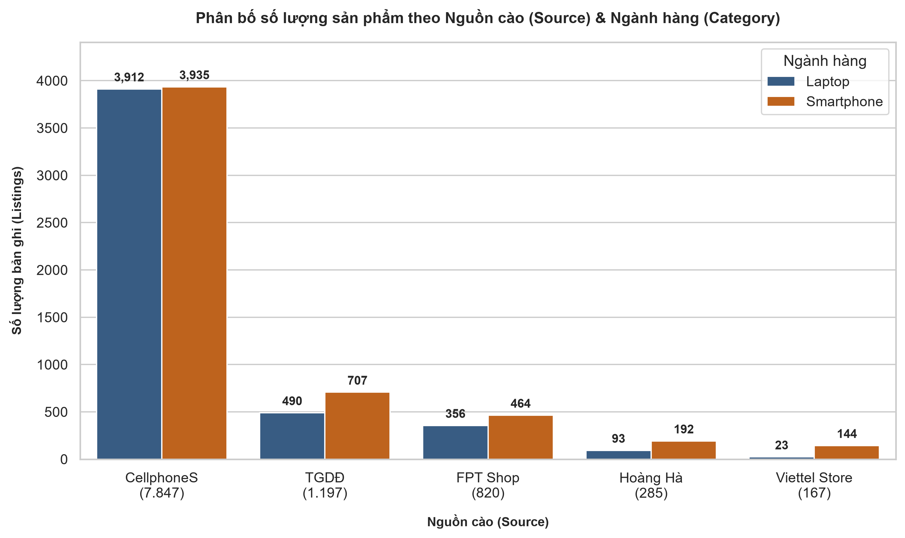
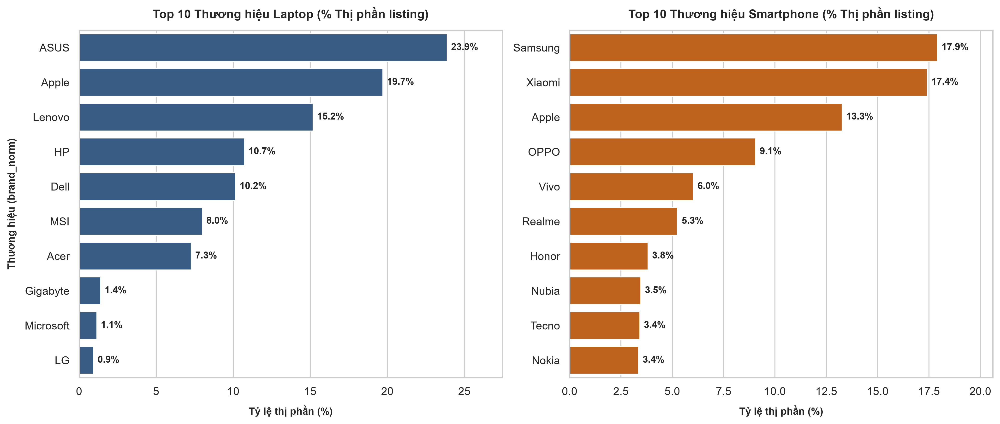
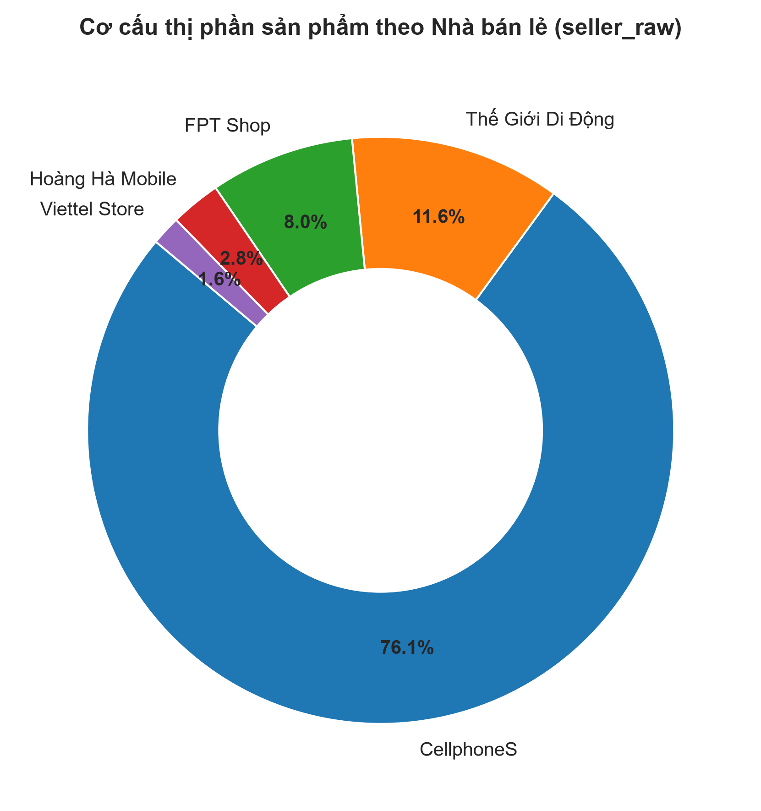

### 5.1.1. Phân bố Dữ liệu theo Nguồn Thu thập (Platform Distribution)
*Căn cứ Bảng 1.1 và 1.2 (Bảng chéo Nguồn x Ngành hàng):*
- **CellphoneS** là nguồn đóng góp dữ liệu lớn nhất với **7.847 sản phẩm (76.07%)**, trong đó cân bằng giữa Laptop (3.912 máy) và Smartphone (3.935 máy).
- **Thế Giới Di Động (TGDD)** chiếm vị trí thứ hai với **1.197 sản phẩm (11.60%)**, trong đó Smartphone chiếm 707 máy và Laptop chiếm 490 máy.
- **FPT Shop** đóng góp **820 sản phẩm (7.95%)**, bao gồm 356 laptop và 464 smartphone.
- **Hoàng Hà Mobile** và **Viettel Store** lần lượt đóng góp **285 sản phẩm (2.76%)** và **167 sản phẩm (1.62%)**, đóng vai trò nguồn bổ trợ quan trọng.

### 5.1.2. Thị phần Thương hiệu (Brand Market Share)
*Căn cứ Bảng 1.3 và 1.4 (Thị phần Top 10 Thương hiệu):*
- **Ngành hàng Smartphone**: Top 3 thương hiệu lớn chiếm **48.61%** thị phần niêm yết:
  1. **Samsung**: Chiếm vị trí số 1 với **975 sản phẩm (17.92%)**, phủ khắp từ dòng giá rẻ Galaxy A đến flagship Galaxy S và Z Fold/Flip.
  2. **Xiaomi**: Chiếm vị trí thứ hai với **948 sản phẩm (17.42%)**, bám đuổi sát nút với ưu thế phân khúc tầm trung và giá rẻ hiệu năng cao.
  3. **Apple**: Đứng thứ ba với **722 sản phẩm (13.27%)**, thống trị tuyệt đối phân khúc cận cao cấp và cao cấp.
  4. Các thương hiệu tiếp theo: OPPO (493 máy - 9.06%), Vivo (328 máy - 6.03%), Realme (286 máy - 5.26%), Honor (208 máy - 3.82%), Nubia (189 máy - 3.47%), Tecno (186 máy - 3.42%), Nokia (183 máy - 3.36%). Nhóm còn lại chiếm 16.98%.
- **Ngành hàng Laptop**: Thị trường Laptop phân hóa rõ nét với 7 nhà sản xuất lớn chiếm tới **95.66%** thị phần:
  1. **ASUS**: Dẫn đầu thị phần với **1.164 sản phẩm (23.88%)**, bao quát từ ZenBook, VivoBook đến ROG/TUF Gaming.
  2. **Apple (MacBook)**: Đứng thứ hai với **961 sản phẩm (19.72%)**, định vị riêng biệt trên nền tảng macOS và Apple Silicon.
  3. **Lenovo**: Đứng thứ ba với **740 sản phẩm (15.18%)**, dẫn đầu dòng doanh nghiệp ThinkPad, IdeaPad và Legion.
  4. **HP**: Chiếm **523 sản phẩm (10.73%)** (Pavilion, Envy, Omen, Victus).
  5. **Dell**: Chiếm **495 sản phẩm (10.16%)** (Inspiron, Vostro, Latitude, XPS, Alienware).
  6. **MSI**: Chiếm **390 sản phẩm (8.00%)** chuyên về laptop gaming và sáng tạo nội dung.
  7. **Acer**: Chiếm **355 sản phẩm (7.28%)** (Aspire, Nitro, Predator).
  8. Nhóm khác (Gigabyte, Microsoft Surface, LG Gram,...): Chiếm 4.34% còn lại.

---

## 5.2. Phân tích Đặc trưng Biến Giá & Mức độ Chiết khấu

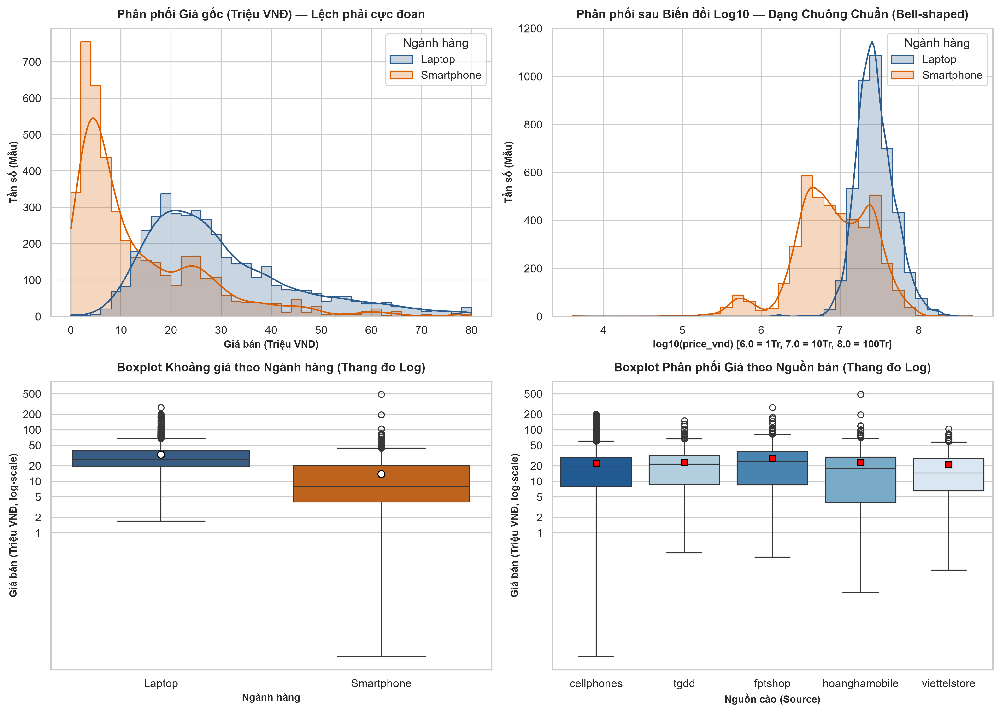
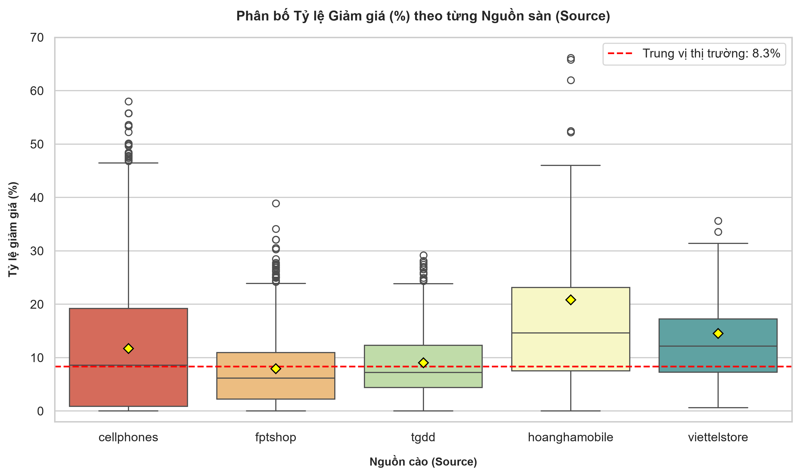

### 5.2.1. Phân phối Bất đối xứng và Hiệu quả của Biến đổi Logarithm
*Căn cứ Bảng 1.7 và 1.8:*
- Biến giá bán (`price_vnd`) trên quy mô toàn thị trường thể hiện tính chất **bất đối xứng lệch phải rất nặng (Positive Skewness)**:
  * **Toàn thị trường**: Giá trung vị (Median) đạt **19.49 Triệu VNĐ**, giá trung bình (Mean) đạt **23.37 Triệu VNĐ**, Skewness $= \mathbf{+3.47}$, Kurtosis $= \mathbf{+34.48}$.
  * **Laptop** ($N = 4.222$ hợp lệ): Skewness $= \mathbf{+2.89}$, Kurtosis $= \mathbf{+13.54}$. Giá trung vị đạt **26.84 Triệu VNĐ**, giá trung bình bị kéo lên **32.99 Triệu VNĐ** bởi các dòng máy trạm và gaming cao cấp (giá cao nhất lên tới 269.99 triệu VNĐ).
  * **Smartphone** ($N = 4.326$ hợp lệ): Skewness $= \mathbf{+7.38}$, Kurtosis $= \mathbf{+170.71}$. Giá trung vị đạt **7.99 Triệu VNĐ**, giá trung bình đạt **13.99 Triệu VNĐ**.
- **Hiệu quả của phép biến đổi $\log_{10}(\text{price})$**:
  * Sau khi lấy logarit, độ lệch của Laptop giảm mạnh từ $+2.89$ về **$+0.29$**, độ nhọn Kurtosis giảm từ $+13.54$ về **$+1.07$** (xấp xỉ phân phối chuẩn đối xứng hình chuông lý tưởng).
  * Độ lệch của Smartphone giảm từ $+7.38$ về **$-0.58$**, độ nhọn giảm từ $+170.71$ về **$+0.89$**.
  * **Khẳng định phương pháp luận**: Biến đổi logarit là điều kiện tiên quyết bắt buộc để các mô hình hồi quy tham số (Linear Regression, Ridge, Lasso) hoạt động hiệu quả, tránh vi phạm giả định về phương sai sai số đồng nhất (Homoscedasticity).

### 5.2.2. Chiến lược Chiết khấu theo Nguồn Bán (Discount Rate Patterns)
*Căn cứ Bảng 1.9:*
- Tỷ lệ có niêm yết giảm giá toàn thị trường đạt **75.0%** (7.737/10.316 sản phẩm). Mức giảm giá trung bình toàn thị trường đạt **$11.50\%$** (Median: $8.34\%$, Q3: $18.19\%$).
- **Hoàng Hà Mobile** và **Viettel Store** có mức chiết khấu niêm yết trung bình cao nhất (trung bình **$20.81\%$** và **$14.53\%$**), phản ánh chiến lược cạnh tranh trực diện về giá khuyến mãi.
- **CellphoneS** duy trì tỷ lệ hàng giảm giá đạt **$77.52\%$** với mức chiết khấu trung bình **$11.70\%$** (Median: $8.57\%$).
- **TGDD** và **FPT Shop** có mức chiết khấu niêm yết trung bình thận trọng hơn (**$9.05\%$** và **$7.95\%$**), tập trung cạnh tranh bằng độ phủ chuỗi cửa hàng, chính sách hậu mãi và phụ kiện tặng kèm.

---

## 5.3. Bức tranh Mức độ Thiếu Dữ liệu (Missingness Profile)

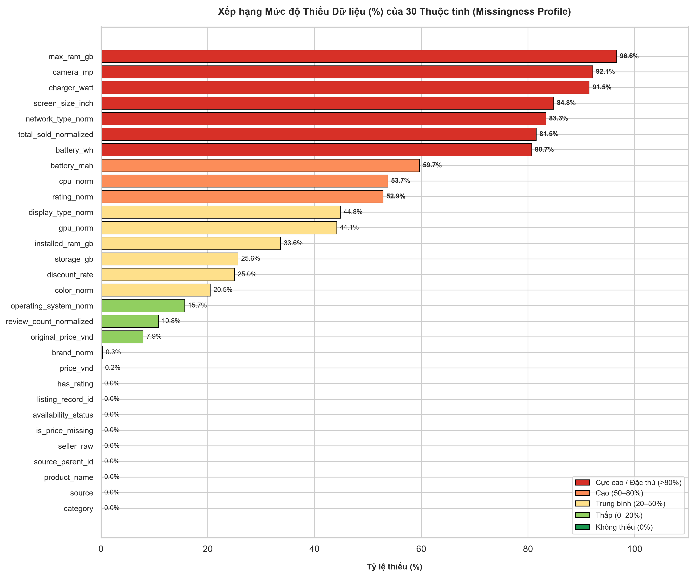
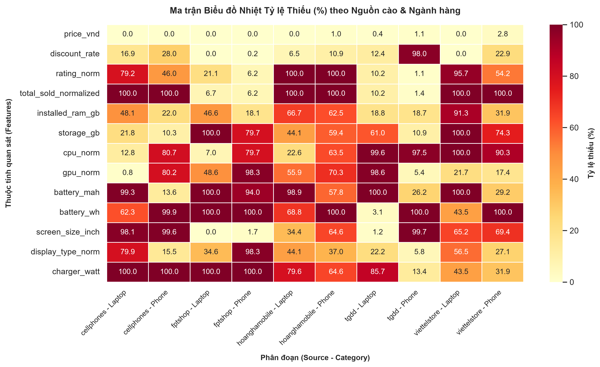
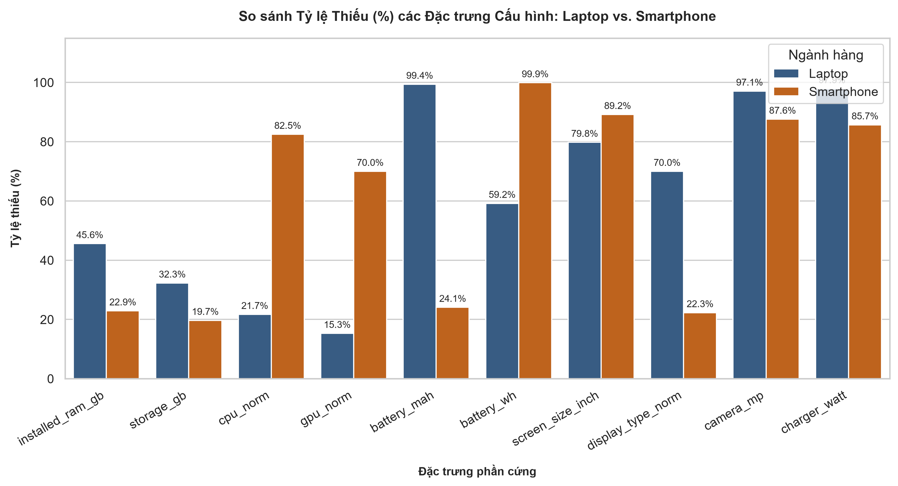

Phân tích mức độ thiếu dữ liệu giúp xác định cơ chế thiếu theo lý thuyết thống kê (Rubin, 1976):
1. **Missing Completely at Random (MCAR)**:
   - Các trường định danh và phân loại nền tảng (`category`, `seller_raw`, `product_name`) đạt tỷ lệ đầy đủ tuyệt đối (**$100\%$**).
   - Trường thương hiệu `brand_norm` chỉ thiếu $0.3\%$ (chủ yếu ở các sản phẩm phụ kiện gán nhầm).
2. **Missing at Random (MAR) do Đặc thù Ngành hàng (Category-specific missingness)**:
   - `battery_wh` hoàn toàn không xuất hiện ở Smartphone (thiếu $100\%$), nhưng xuất hiện ở $40.8\%$ Laptop.
   - `battery_mah` xuất hiện ở $74.9\%$ Smartphone, nhưng gần như vắng mặt ở Laptop (thiếu $98.2\%$).
   - `gpu_norm` chỉ thiếu $15.6\%$ ở Laptop, nhưng thiếu tới $69.8\%$ ở Smartphone.
   - *Kết luận*: Hiện tượng thiếu này hoàn toàn có thể dự đoán được dựa trên biến danh mục `category`, do đó việc tách riêng hai pipeline mô hình hóa cho Laptop và Smartphone là hoàn toàn khoa học.
3. **Missing Not at Random (MNAR) do Giới hạn Bóc tách từ Crawler**:
   - `charger_watt` (thiếu $91.5\%$) và `screen_size_inch` (thiếu $84.8\%$) có tỷ lệ thiếu rất cao do nhiều sàn không cung cấp trường thông số riêng mà nhúng vào đoạn văn bản mô tả HTML tự do.

---

## 5.4. Phân tích Tương quan Cấu hình - Giá bán & So sánh Đối đầu Laptop vs. Smartphone

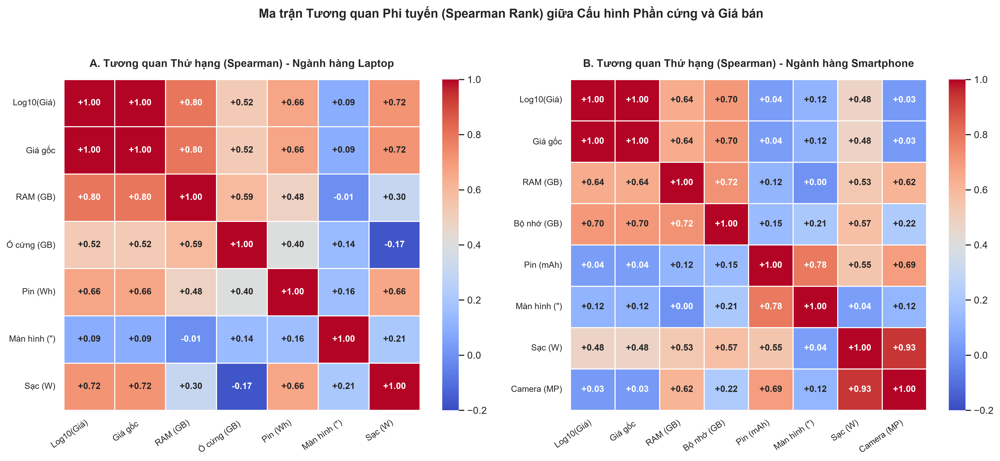
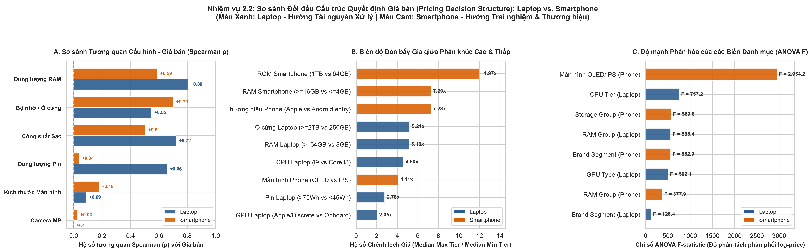

### 5.4.1. Cấu trúc Quyết định Giá Ngành hàng Laptop (Workstation & Productivity Asset)
*Căn cứ Bảng 2.1A, 2.1C, 2.1D, 2.1E, 2.1F:*
- **Dung lượng RAM (`installed_ram_gb`)** là yếu tố có tương quan thứ hạng mạnh nhất với giá bán ($\rho = \mathbf{+0.803}$, Log-Pearson $r = +0.729$). Bước nhảy giá giữa các bậc RAM diễn ra cực kỳ dứt khoát:
  * 8 GB: Trung vị 18.64 Triệu VNĐ.
  * 16 GB: Trung vị 28.99 Triệu VNĐ (+55.5%).
  * 32 GB: Trung vị 51.49 Triệu VNĐ (+77.6%).
  * $\ge 64$ GB: Trung vị 96.24 Triệu VNĐ (+86.9%).
  * Biên độ giãn giá đạt **5.16 lần** giữa bậc $\ge 64$GB và 8GB.
- **Phân tầng Vi xử lý CPU (`cpu_tier`)** có năng lực phân tách phân phối giá cực đại (One-Way ANOVA $F = \mathbf{757.2}$, Kruskal-Wallis $H = \mathbf{1748.8}$, $p < 10^{-300}$):
  * Core i3 / Entry-level: Trung vị 11.95 Triệu.
  * Core i5 / Ryzen 5 (Mainstream): Trung vị 19.24 Triệu.
  * Core i7 / Ryzen 7 (High-end): Trung vị 27.49 Triệu.
  * Apple Silicon (M-series): Trung vị 43.99 Triệu.
  * Core i9 / Ryzen 9 (Flagship/Enthusiast): Trung vị 54.99 Triệu (**gấp 4.60 lần** so với Core i3).
- **Phân loại GPU Đồ họa (`gpu_type`)** (ANOVA $F = \mathbf{399.8}$, Kruskal-Wallis $H = \mathbf{927.5}$, $p < 10^{-200}$):
  * Onboard: Trung vị 19.99 Triệu VNĐ.
  * Card rời (Dedicated GPU - RTX/GTX/Radeon): Trung vị 28.99 Triệu VNĐ (Mean: 35.61 Triệu).
  * Apple GPU: Trung vị 40.99 Triệu VNĐ.
- **Công suất Sạc và Dung lượng Pin Wh**: Đồng biến rất mạnh với giá bán (Sạc $\rho = +0.722$, Pin Wh $\rho = +0.658$). Do các cỗ máy hiệu năng cao bắt buộc phải đi kèm khối nguồn công suất lớn (135W–330W) và pin dung tích lớn ($>75$Wh).
- **Nghịch lý Màn hình Laptop**: Kích thước màn hình ($\rho = +0.093$) hầu như không có ý nghĩa phân hóa giá. Các dòng Ultrabook 13–14 inch mỏng nhẹ cao cấp có giá ngang bằng hoặc cao hơn đáng kể so với laptop 15.6 inch phổ thông.

### 5.4.2. Cấu trúc Quyết định Giá Ngành hàng Smartphone (Consumer Experience & Brand Equity)
*Căn cứ Bảng 2.1B, 2.1G, 2.1H, 2.1I, 2.1J:*
- **Bộ nhớ trong ROM (`storage_gb`)** là đòn bẩy giãn giá mạnh nhất toàn bộ thị trường ($\rho = \mathbf{+0.704}$, ANOVA $F = \mathbf{777.7}$, Kruskal-Wallis $H = \mathbf{1736.6}$):
  * $\le 64$ GB: Trung vị 3.49 Triệu VNĐ.
  * 128 GB: Trung vị 6.55 Triệu VNĐ.
  * 256 GB: Trung vị 16.49 Triệu VNĐ.
  * 512 GB: Trung vị 25.59 Triệu VNĐ.
  * $\ge 1$ TB: Trung vị 41.79 Triệu VNĐ.
  * Biên độ chênh lệch giá giữa 1TB và $\le 64$GB lên tới **11.97 lần**! Đây là công cụ phân tầng biên lợi nhuận bậc thang (Tiered Upsell) triệt để của các nhà sản xuất flagship.
- **Công nghệ Màn hình (`display_group`)** thể hiện năng lực phân hóa giá khủng khiếp nhất toàn thị trường (ANOVA $F = \mathbf{2954.2}$, Kruskal-Wallis $H = \mathbf{1826.5}$, $p < 10^{-300}$):
  * IPS / LCD: Trung vị 3.89 Triệu VNĐ (đại diện phân khúc giá rẻ).
  * OLED / AMOLED: Trung vị 15.99 Triệu VNĐ (đắt gấp **4.11 lần** so với màn LCD).
- **Thương hiệu định vị (`brand_norm`)** (ANOVA $F = \mathbf{210.2}$, Kruskal-Wallis $H = \mathbf{2335.6}$, $p < 10^{-300}$):
  * Apple đứng đầu với Trung vị 25.49 Triệu VNĐ (Q3: 33.49 Triệu).
  * Samsung đứng thứ hai với Trung vị 15.84 Triệu VNĐ.
  * Xiaomi, OPPO, Vivo, Realme tập trung ở phân khúc 4.0 – 6.5 Triệu VNĐ.
  * Nokia ở phân khúc phổ thông với Trung vị 1.57 Triệu VNĐ.
  * Biên độ thương hiệu tạo mức chênh lệch giá lên tới **7.28x – 16.24x**.
- **Hai Nghịch lý Phần cứng Smartphone**:
  1. **Nghịch lý Pin mAh ($\rho = +0.036$)**: Không phân hóa giá do giới hạn vật lý về kích thước bàn tay người dùng. Cả điện thoại giá rẻ 2 triệu lẫn flagship 35 triệu đều trang bị viên pin quanh mốc 5.000 mAh.
  2. **Nghịch lý Camera MP ($\rho = +0.028$, $p = 0.493$ không có ý nghĩa thống kê)**: Cuộc đua thông số MP thuần túy mang tính marketing ở phân khúc giá rẻ (trang bị camera 50–108MP cảm biến nhỏ), trong khi các flagship đầu bảng cạnh tranh bằng kích thước cảm biến vật lý lớn, ống kính tiềm vọng và thuật toán xử lý ảnh tính toán (Computational Photography).

### 5.4.3. Bảng Ma trận Đối chiếu Cấu trúc Quyết định Giá Tổng hợp
*Trích xuất từ Bảng 2.2C:*

| Khía cạnh đối chiếu | Ngành hàng Laptop | Ngành hàng Smartphone | Khác biệt căn bản |
| :--- | :--- | :--- | :--- |
| **Triết lý Định giá** | Thiết bị sản xuất / Tài sản làm việc (*Productivity Asset*). | Thiết bị trải nghiệm cá nhân & phong cách sống (*Consumer Lifestyle*). | Laptop định giá từ chi phí linh kiện lên; Smartphone định giá từ giá trị thương hiệu xuống. |
| **Đòn bẩy Giá Hàng đầu** | Dung lượng RAM ($\rho = +0.80$) & Phân tầng CPU ($F = 757.2$). | Bộ nhớ trong ROM ($\rho = +0.70$) & Thương hiệu ($H = 2335.6, F = 210.2$). | Laptop dùng RAM để lọc người dùng chuyên nghiệp; Smartphone dùng ROM để Upsell bậc thang. |
| **Ranh giới Phân tách Thị trường** | Card đồ họa rời (Dedicated GPU vs Onboard). | Công nghệ Màn hình (OLED/AMOLED vs IPS/LCD, $F = 2954.2$). | Laptop phân hóa ở năng lực đồ họa; Smartphone phân hóa ở chất lượng thị giác. |
| **Vai trò Pin & Nguồn điện** | Tương quan đồng biến rất mạnh (Sạc $\rho = +0.72$, Pin Wh $\rho = +0.66$). | Nghịch lý bão hòa vật lý (Pin mAh $\rho = +0.04$, bão hòa 5000 mAh). | Pin Laptop là biến hiệu năng cao cấp; Pin Smartphone là thuộc tính cơ bản tối thiểu. |
| **Chỉ số Bão hòa / Non-driver** | Kích thước màn hình ($\rho = +0.09$, Ultrabook nhỏ nhưng đắt). | Độ phân giải Camera MP ($\rho = +0.03$, không có ý nghĩa thống kê). | Cả hai ngành hàng đều có những chỉ số phần cứng không mang tính quyết định giá. |

---

## 5.5. Đánh giá Chất lượng Dữ liệu cho Bài toán Hồi quy (Regression Readiness Audit)

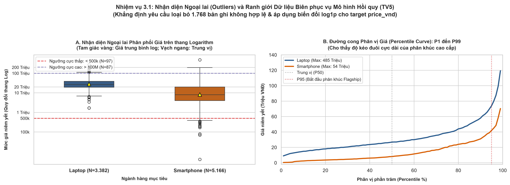
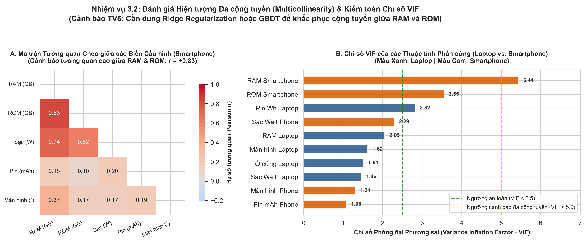
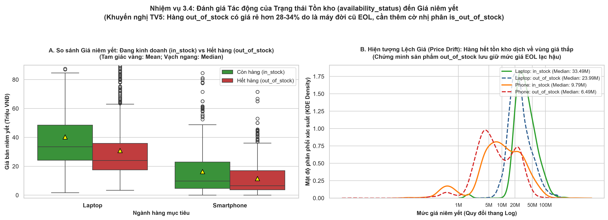

### 5.5.1. Nhận diện Outliers & Dữ liệu biên (Task 3.1)
*Căn cứ Bảng 3.1A, 3.1B, 3.1C:*
- **Dữ liệu lỗi / thiếu giá**: Phát hiện chính xác **1.768 bản ghi không hợp lệ** (1.752 bản ghi có `is_price_missing == True` / `price_vnd <= 0` và 16 bản ghi thiếu giá hoàn toàn). Bắt buộc loại bỏ hoàn toàn nhóm này, giữ lại **8.548 bản ghi sạch**.
- **Nhóm giá cực thấp ($< 500.000$ VNĐ - 97 sản phẩm)**: Chủ yếu là dòng điện thoại cơ bản "cục gạch" (Itel, Masstel, Energizer) và 4 phụ kiện gán nhầm. Cần lọc bỏ nếu mô hình dự đoán chỉ nhắm đến Smartphone thông minh.
- **Nhóm giá cực cao ($> 100.000.000$ VNĐ - 87 sản phẩm)**: Toàn bộ là Laptop Gaming / Mobile Workstation cao cấp thực tế (MacBook Pro M3 Max 128GB/8TB 180 triệu, ROG Strix SCAR 18, MSI Titan 18 HX 130–150 triệu). Đây là ngoại lai tự nhiên chuẩn xác; biến đổi target $\log(1+y)$ sẽ xử lý triệt để nhóm này mà không làm méo mó mô hình.

### 5.5.2. Đo lường Hiện tượng Đa cộng tuyến & Cảnh báo VIF (Task 3.2)
*Căn cứ Bảng 3.2A, 3.2B, 3.2C:*
- Tại ngành hàng Smartphone, **Dung lượng RAM** và **Bộ nhớ ROM** có tương quan chéo Pearson rất cao ($r = \mathbf{+0.833}$), đẩy chỉ số $VIF$ của RAM lên mức **$5.44$** (vượt ngưỡng cảnh báo an toàn $VIF > 5.0$).
- *Khuyến nghị TV5*: Hiện tượng đa cộng tuyến này sẽ làm phình to phương sai ước lượng trọng số trong mô hình OLS tuyến tính. TV5 cần áp dụng **Ridge Regression ($L_2$ Regularization)** hoặc ưu tiên sử dụng **GBDT (LightGBM/XGBoost/CatBoost)**.

### 5.5.3. Phòng chống Rò rỉ Dữ liệu (Task 3.3)
*Căn cứ Bảng 3.3:*
- Bắt buộc đưa vào **BLACKLIST**: `discount_rate` (rò rỉ trực tiếp 100% nhãn target), `original_price_vnd` (tương quan $r = 0.96$), `listing_record_id`, `source_parent_id`, `crawl_time`, `crawl_batch`, `is_price_missing`.

### 5.5.4. Tác động của Trạng thái Tồn kho & Hiện tượng Price Drift (Task 3.4)
*Căn cứ Bảng 3.4A, 3.4B:*
- Kiểm định phi tham số Mann-Whitney U test khẳng định sự khác biệt giá cực kỳ sâu sắc giữa hàng còn tồn kho (`in_stock`) và hàng hết (`out_of_stock`):
  * **Laptop**: Hàng `in_stock` đắt hơn `out_of_stock` tới **+9.50 Triệu (+39.6%)**, $U = 1.036.180, p = 3.98 \times 10^{-37}$.
  * **Smartphone**: Hàng `in_stock` đắt hơn `out_of_stock` tới **+3.30 Triệu (+50.9%)**, $U = 1.982.360, p = 1.02 \times 10^{-17}$.
- *Bản chất*: Hàng hết tồn kho là các sản phẩm đời cũ đã ngừng kinh doanh (EOL) được lưu trữ mức giá cũ. TV5 bắt buộc bổ sung cờ nhị phân `is_out_of_stock` để mô hình bù trừ độ lệch giá này.

---

## 5.6. Gói Khuyến nghị Kỹ thuật Đặc trưng và Bàn giao cho TV5

1. **Huấn luyện 2 pipeline mô hình độc lập**: 1 cho Laptop, 1 cho Smartphone.
2. **Target Transform**: Áp dụng $\log(1 + y)$ qua `TransformedTargetRegressor(func=np.log1p, inverse_func=np.expm1)`.
3. **Imputation**: Điền Median có phân tầng theo `(category, brand_norm)`. Bổ sung cờ `_is_missing` cho các trường thiếu $> 30\%$.
4. **Encoding**: One-Hot cho `display_type_norm` (OLED vs LCD). Target Encoding (out-of-fold có smoothing) cho `brand_norm` và `seller_raw`.
5. **Feature Engineering**: Tạo biến tương tác `ram_x_storage`, cờ đồ họa `is_dedicated_gpu` cho Laptop; cờ công nghệ `is_oled_amoled` và phân đoạn ROM bậc thang cho Smartphone.
6. **Mô hình Khuyến nghị**: Ưu tiên **LightGBM / XGBoost / CatBoost** kết hợp với bộ đánh giá Metric phân tầng ($R^2$, MAE, MAPE, RMSE) trên tập `in_stock`.

---

## 5.7. Tuyên bố Bằng chứng Khám phá (Exploratory vs. Causal Caveat)

> [!IMPORTANT]
> **Tuyên bố khoa học bắt buộc (Mandatory Scientific Caveat)**:
> *"Các phân tích tương quan ($\rho, r$), mức độ quan trọng đặc trưng (Feature Importance) và các kiểm định thống kê ($F, H, U$) được trình bày trong báo cáo này phản ánh các mối liên hệ thống kê thực nghiệm (statistical associations) được khám phá từ snapshot dữ liệu thị trường TMĐT Việt Nam. Đây là bằng chứng khám phá phục vụ tối ưu hóa năng lực dự đoán giá (Predictive Modeling) cho Thành viên 5, **tuyệt đối không được coi là kết luận về quan hệ nhân quả (Causal Inference)** (ví dụ: việc một chiếc laptop có thêm 8GB RAM trên thị trường không đồng nghĩa với việc trực tiếp làm tăng chi phí sản xuất một khoản tiền cố định tương ứng)."*
