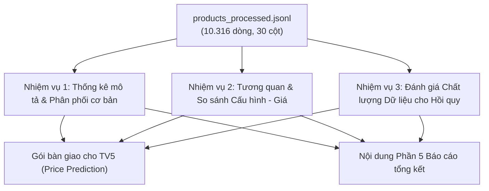

# Hướng dẫn & Kế hoạch Thực hiện Nhiệm vụ TV3 (Exploratory Data Analysis - EDA)

Tài liệu này xác định chi tiết phạm vi công việc, dữ liệu đầu vào, các phân tích cần thực hiện, tiêu chuẩn chất lượng và sản phẩm bàn giao của **Thành viên 3 (TV3 - EDA)** trong dự án `it4930-ecommerce-data-intelligence`. Mọi quy tắc và căn cứ trong tài liệu này đều được đối chiếu và truy nguyên trực tiếp từ hệ thống tài liệu quy chuẩn kỹ thuật của dự án.

---

## 1. Bảng Đối chiếu Nguồn Tài liệu Quy chuẩn (Document Traceability Matrix)

Mọi yêu cầu nghiệp vụ, định dạng dữ liệu và quy tắc ràng buộc của TV3 được trích xuất và đối chiếu từ các tài liệu gốc sau:

| STT | Tài liệu tham chiếu | Phạm vi & Quy chuẩn trích xuất cho TV3 |
|---|---|---|
| 1 | [README.md (Mục TV1 & TV2)](../../README.md#L3-L210) | • Phạm vi 2 danh mục mục tiêu: `laptop` và `smartphone`.<br>• Danh sách 5 nguồn dữ liệu thực tế: `cellphones`, `tgdd`, `fptshop`, `hoanghamobile`, `viettelstore`.<br>• Bàn giao dữ liệu sạch: `data/processed/products_processed.jsonl` (10.316 listings, 30 trường).<br>• Quy ước rating: `rating_raw = 0` $\rightarrow$ `rating_norm = null`, `has_rating = false`. |
| 2 | [docs/feature_contracts_tv3_tv8.md](../feature_contracts_tv3_tv8.md) | • **Mục 1**: Quy ước tên trường canonical chuẩn (dùng `price_vnd`, không dùng alias cũ `price_value`,...).<br>• **Mục 2**: Phân loại nhóm trường dùng chung, feature số và cờ chất lượng.<br>• **Mục 3 (TV3 – EDA)**: Tập trường tối thiểu bắt buộc; yêu cầu báo cáo missing theo từng source; cấm coi `has_rating = false` là rating 0.<br>• **Mục 3 (TV5 – Price prediction)**: Danh sách candidate features, target mặc định `price_vnd` tại snapshot; quy tắc chống leakage (không dùng id, crawl time). |
| 3 | [docs/gold_handoff.md](../gold_handoff.md) | • **Mục 1 & 2**: Bảng dữ liệu dành cho TV3 (`dim_source_parents`, `fact_listings`), phạm vi khóa `source_parent_id`.<br>• **Mục 3**: Quy tắc diễn giải: 10.316 dòng là listing quan sát được, không phải số model độc lập; không có entity resolution toàn cục xuyên sàn; cờ bất thường là bằng chứng quan sát, không phải nhãn lỗi cuối cùng. |
| 4 | [docs/data_contract_tv2_v1.md](../data_contract_tv2_v1.md) | • **Mục Phạm vi & Bảng Gold**: Quy định grain dòng và tính bất biến của raw.<br>• **Mục Cờ chất lượng & Trường chuẩn hóa Silver v2**: Định nghĩa các cờ `is_price_missing`, `is_price_zero`, `availability_status` (`in_stock`, `out_of_stock`, `unknown`). |
| 5 | [docs/data_field_decision_matrix.md](../data_field_decision_matrix.md) | • **Mục 1**: Nguyên tắc xử lý missing: phân biệt rõ ràng giữa `NULL`, chuỗi rỗng, `0` và chuỗi "Liên hệ". Cấm tự ý điền trung vị ở lớp dữ liệu chung.<br>• **Mục 2 & 4**: Quyết định trường: `raw_payload`, ID và URL chỉ phục vụ provenance, không đưa vào mô hình. |
| 6 | [docs/data_quality_report_tv2_v1.md](../data_quality_report_tv2_v1.md) | • **Mục 1 & 2**: Thống kê số lượng ban đầu: 10.316 listing từ 18 file raw; các vấn đề phát hiện trong raw (giá 0, rating FPT, missing `total_sold`).<br>• **Mục 4 & 5**: Bảng đối chiếu trước và sau chuẩn hóa, những điều TV2 không làm (không xóa dòng, không tự động điền missing). |
| 7 | [docs/pipeline_execution_v1.md](../pipeline_execution_v1.md) | • **Mục Stage S0–S8**: Quy trình chuyển đổi dữ liệu, kiểm soát chất lượng qua từng stage và điều kiện pass quality gates. |

---

## 2. Thông tin chung & Vị trí làm việc

* **Vị trí**: TV3 – Chuyên viên Phân tích Khám phá Dữ liệu (Exploratory Data Analyst)
* **Thư mục làm việc**: `src/eda/`
* **Dữ liệu đầu vào chính**: [data/processed/products_processed.jsonl](../../data/processed/products_processed.jsonl) (10.316 bản ghi, 30 trường)
* **Đối tác tiếp nhận chính (Downstream)**: 
  * **TV5** (Xây dựng mô hình hồi quy dự đoán giá bán - Price Prediction) theo contract tại [docs/feature_contracts_tv3_tv8.md#L51-L56](../feature_contracts_tv3_tv8.md#L51-L56).
  * **Báo cáo tổng kết dự án**: Chịu trách nhiệm hoàn thành toàn bộ **Phần 5: Phân tích Khám phá Dữ liệu (EDA)**.

---

## 3. Quy ước Schema & Danh mục 30 Thuộc tính (Data Schema & Canonical Fields)

Theo Data Contract quy định tại [docs/feature_contracts_tv3_tv8.md#L7-L16](../feature_contracts_tv3_tv8.md#L7-L16) và số liệu thống kê thực tế từ [data/processed/products_processed.jsonl](../../data/processed/products_processed.jsonl):

| Nhóm thuộc tính | Tên trường canonical | Kiểu dữ liệu | Non-Null | Tỷ lệ đầy đủ | Ý nghĩa, quy tắc & nguồn tham chiếu |
|---|---|---|---:|---:|---|
| **Định danh & Phân nhóm**<br>*(7 trường)* | `listing_record_id` | `str` | 10.316 | 100.0% | Khóa hash định danh từng dòng quan sát ([gold_handoff.md#L19](../gold_handoff.md#L19)). |
| | `source_parent_id` | `str` | 10.316 | 100.0% | Khóa sản phẩm cha theo từng nguồn ([gold_handoff.md#L18](../gold_handoff.md#L18)). |
| | `product_name` | `str` | 10.316 | 100.0% | Tên hiển thị của sản phẩm đã loại bỏ hậu tố marketing cơ bản. |
| | `source` | `str` | 10.316 | 100.0% | Nguồn sàn: `cellphones` (7.847), `tgdd` (1.197), `fptshop` (820), `hoanghamobile` (285), `viettelstore` (167). |
| | `category` | `str` | 10.316 | 100.0% | Ngành hàng: `smartphone` (5.442) và `laptop` (4.874) ([README.md#L7-L9](../../README.md#L7-L9)). |
| | `brand_norm` | `str` | 10.288 | 99.7% | Thương hiệu đã chuẩn hóa theo từ điển ([feature_contracts_tv3_tv8.md#L41](../feature_contracts_tv3_tv8.md#L41)). |
| | `seller_raw` | `str` | 10.316 | 100.0% | Tên cửa hàng/đơn vị bán lẻ. |
| **Giá & Tồn kho**<br>*(5 trường)* | `price_vnd` | `float` | 10.300 | 99.8% | **Target chính**: Giá bán quan sát (VNĐ), thay thế cho `price_value` cũ. |
| | `original_price_vnd` | `float` | 9.503 | 92.1% | Giá niêm yết ban đầu trước chiết khấu (VNĐ). |
| | `discount_rate` | `float` | 7.737 | 75.0% | Tỷ lệ giảm giá (%) ([data_quality_report_tv2_v1.md#L62](../data_quality_report_tv2_v1.md#L62)). |
| | `is_price_missing` | `bool` | 10.316 | 100.0% | Cờ phát hiện lỗi giá hoặc giá bằng 0 ([data_contract_tv2_v1.md#L30](../data_contract_tv2_v1.md#L30)). |
| | `availability_status` | `str` | 10.316 | 100.0% | Trạng thái: `in_stock`, `out_of_stock`, `unknown` ([data_quality_report_tv2_v1.md#L61](../data_quality_report_tv2_v1.md#L61)). |
| **Đánh giá & Xã hội**<br>*(4 trường)* | `has_rating` | `bool` | 10.316 | 100.0% | Cờ boolean có đánh giá hay không ([README.md#L176](../../README.md#L176)). |
| | `rating_norm` | `float` | 4.863 | 47.1% | Điểm rating chuẩn hóa (thang 1.0–5.0). **Không điền 0 khi missing**. |
| | `review_count_normalized`| `float` | 9.207 | 89.2% | Tổng số lượt đánh giá khách hàng. |
| | `total_sold_normalized` | `float` | 1.904 | 18.5% | Lượng sản phẩm đã bán (chỉ một số sàn cung cấp). |
| **Cấu hình phần cứng**<br>*(7 trường)* | `installed_ram_gb` | `float` | 6.847 | 66.4% | Dung lượng RAM đang lắp đặt (GB). |
| | `storage_gb` | `float` | 7.670 | 74.3% | Dung lượng bộ nhớ trong/ổ cứng (GB). |
| | `cpu_norm` | `str` | 4.773 | 46.3% | Vi xử lý đã chuẩn hóa ([data_quality_report_tv2_v1.md#L197](../data_quality_report_tv2_v1.md#L197)). |
| | `gpu_norm` | `str` | 5.761 | 55.8% | Card màn hình đồ họa (chủ yếu trên Laptop). |
| | `battery_mah` | `float` | 4.159 | 40.3% | Dung lượng pin theo mAh (chủ yếu trên Smartphone). |
| | `battery_wh` | `float` | 1.994 | 19.3% | Dung lượng pin theo Wh (chủ yếu trên Laptop). |
| | `max_ram_gb` | `float` | 353 | 3.4% | Giới hạn RAM nâng cấp tối đa (GB). |
| **Cấu hình bổ sung**<br>*(7 trường)* | `operating_system_norm` | `str` | 8.698 | 84.3% | Hệ điều hành (Windows 11, iOS, Android, macOS,...). |
| | `color_norm` | `str` | 8.204 | 79.5% | Màu sắc sản phẩm. |
| | `display_type_norm` | `str` | 5.691 | 55.2% | Công nghệ tấm nền (OLED, AMOLED, IPS, Retina,...). |
| | `screen_size_inch` | `float` | 1.570 | 15.2% | Kích thước màn hình (inch). |
| | `network_type_norm` | `str` | 1.720 | 16.7% | Chuẩn kết nối mạng (5G, 4G, Wifi 6,...). |
| | `charger_watt` | `float` | 880 | 8.5% | Công suất củ sạc nhanh kèm theo (Watt). |
| | `camera_mp` | `float` | 814 | 7.9% | Độ phân giải camera chính (MP, chủ yếu Smartphone). |

> [!WARNING]
> **Các quy tắc nghiêm ngặt bắt buộc tuân thủ của TV3**:
> 1. **Báo cáo missing theo nguồn (`source`)**: Theo [docs/feature_contracts_tv3_tv8.md#L43](../feature_contracts_tv3_tv8.md#L43), TV3 bắt buộc phải phân tích tỷ lệ missing theo từng `source` và `category`, không được chỉ đưa ra một tỷ lệ gộp chung toàn thị trường.
> 2. **Không gán 0 cho rating thiếu**: Tuyệt đối không tính trung bình rating bằng cách coi `has_rating = false` hoặc `rating_norm = null` là rating 0 ([docs/feature_contracts_tv3_tv8.md#L43](../feature_contracts_tv3_tv8.md#L43) và [README.md#L173-L177](../../README.md#L173-L177)).
> 3. **Không đồng nhất hóa listing xuyên sàn**: Theo [docs/gold_handoff.md#L18](../gold_handoff.md#L18), 10.316 dòng là các quan sát listing riêng lẻ tại từng sàn. Không được tự ý gộp hai listing có cùng tên giữa các cửa hàng khác nhau thành một thực thể duy nhất nếu chưa có entity resolution.

---

## 4. Chi tiết các nhiệm vụ cụ thể cần triển khai



### Nhiệm vụ 1: Thống kê mô tả & Phân phối cơ bản (Univariate & Group Distributions)
*Căn cứ yêu cầu tại [docs/feature_contracts_tv3_tv8.md#L39-L44](../feature_contracts_tv3_tv8.md#L39-L44)*

1. **Phân phối sản phẩm, thị phần & nguồn bán**:
   * Lập bảng chéo phân bố listing: `source` $\times$ `category` (Cellphones: 7.847, TGDĐ: 1.197, FPT Shop: 820, Hoàng Hà: 285, Viettel Store: 167; Smartphone: 5.442, Laptop: 4.874).
   * Phân tích thị phần thương hiệu (`brand_norm`) theo từng ngành hàng: Top hãng Laptop (Dell, Asus, HP, Lenovo, Apple, Acer,...) vs Top hãng Smartphone (Apple, Samsung, Xiaomi, OPPO, Vivo,...).
   * Thống kê sự tập trung của nhà bán lẻ (`seller_raw`).
2. **Phân tích biến Giá (`price_vnd`, `original_price_vnd`, `discount_rate`)**:
   * Tính các chỉ số thống kê mô tả: Số lượng mẫu hữu hiệu, Mean, Median, Độ lệch chuẩn (Std), Min, Q1, Q3, Max, Skewness, Kurtosis.
   * Vẽ biểu đồ phân phối giá: Histogram, KDE plot và Boxplot theo từng danh mục `laptop` và `smartphone`.
   * Khám phá phân phối đuôi dài lệch phải (right-skewed / heavy-tail); trực quan hóa phép biến đổi log: $\log(1 + \text{price\_vnd})$.
   * Phân tích phân bố tỷ lệ chiết khấu (`discount_rate`) theo từng nguồn bán.
3. **Phân tích mức độ thiếu dữ liệu (Missingness Profile)**:
   * Tính tỷ lệ missing (%) của toàn bộ 30 cột.
   * **Bắt buộc**: Phân rã ma trận missing rate theo ma trận 2 chiều: `source` $\times$ `category`. Làm rõ tại sao một số thuộc tính chỉ xuất hiện ở nguồn/ngành hàng cụ thể (ví dụ: `battery_wh` tập trung ở Laptop, `battery_mah` và `camera_mp` tập trung ở Smartphone, `total_sold_normalized` chỉ có ở một số sàn).

### Nhiệm vụ 2: Phân tích tương quan & So sánh Cấu hình - Giá bán (Bivariate & Hardware Analysis)
*Căn cứ danh sách candidate features tại [docs/feature_contracts_tv3_tv8.md#L51-L56](../feature_contracts_tv3_tv8.md#L51-L56)*

1. **Mối liên hệ giữa Giá và Cấu hình phần cứng**:
   * Tương quan giữa `price_vnd` (và $\log(\text{price})$) với các biến số:
     * RAM (`installed_ram_gb`), Bộ nhớ trong (`storage_gb`), Kích thước màn hình (`screen_size_inch`), Pin (`battery_mah`, `battery_wh`), Công suất sạc (`charger_watt`).
     * Tính hệ số tương quan Pearson (tuyến tính) và Spearman / Kendall Tau (phi tuyến/thứ hạng).
   * Mối liên hệ giữa Giá và các biến phân loại danh mục (Categorical):
     * Giá theo Dòng vi xử lý (`cpu_norm`), GPU (`gpu_norm`), Hệ điều hành (`operating_system_norm`), Thương hiệu (`brand_norm`).
     * Sử dụng Boxplot / Violin plot phân tầng theo phân khúc giá (Budget, Mid-range, Flagship / Premium).
     * Thực hiện kiểm định thống kê ANOVA hoặc Kruskal-Wallis Test để khẳng định sự khác biệt về giá giữa các nhóm cấu hình/thương hiệu có ý nghĩa thống kê ($p < 0.05$).
2. **So sánh chuyên sâu: Laptop vs. Smartphone**:
   * Lập bảng đối chiếu cấu trúc quyết định giá giữa hai ngành hàng:
     * **Laptop**: Trọng số giá phân hóa mạnh theo CPU tier (Intel Core i3/i5/i7/i9, AMD Ryzen, Apple M-series), sự hiện diện của GPU rời (`gpu_norm`), dung lượng RAM (`installed_ram_gb`) và dung lượng pin Wh.
     * **Smartphone**: Trọng số giá phân hóa mạnh theo Thương hiệu (Apple/Samsung Flagship vs phổ thông), Dung lượng ROM/Storage (`storage_gb`), Công nghệ màn hình (`display_type_norm` OLED/AMOLED) và Camera MP.

### Nhiệm vụ 3: Đánh giá chất lượng dữ liệu ảnh hưởng đến bài toán Hồi quy (Regression Readiness)
*Căn cứ cảnh báo chất lượng từ [docs/data_quality_report_tv2_v1.md#L21-L49](../data_quality_report_tv2_v1.md#L21-L49) và [docs/data_contract_tv2_v1.md#L24-L27](../data_contract_tv2_v1.md#L24-L27)*

1. **Nhận diện Outliers & Dữ liệu biên**:
   * Kiểm tra 16 bản ghi có `is_price_missing == true` hoặc `price_vnd <= 0` ([data_quality_report_tv2_v1.md#L26](../data_quality_report_tv2_v1.md#L26)).
   * Sản phẩm có giá cực thấp (dưới 500.000 VNĐ - nghi vấn linh kiện phụ kiện gán nhầm danh mục) hoặc giá cực cao (>100.000.000 VNĐ).
2. **Hiện tượng Đa cộng tuyến (Multicollinearity)**:
   * Đo lường tương quan chéo giữa các biến độc lập (ví dụ: RAM tương quan cao với Storage; GPU mạnh thường đi kèm CPU cao cấp và pin lớn).
   * Cảnh báo Variance Inflation Factor (VIF) cho TV5 nếu áp dụng các mô hình tuyến tính (OLS, Ridge, Lasso).
3. **Phòng chống Rò rỉ dữ liệu (Data Leakage Risks)**:
   * Khẳng định danh sách trường **tuyệt đối không được đưa vào huấn luyện mô hình** theo [docs/feature_contracts_tv3_tv8.md#L55](../feature_contracts_tv3_tv8.md#L55): `listing_record_id`, `source_parent_id`, `crawl_time`, `crawl_batch`, `discount_rate` (leakage trực tiếp từ target).
4. **Tác động của trạng thái tồn kho (`availability_status`)**:
   * Kiểm tra xem các sản phẩm `out_of_stock` có giá niêm yết cũ/lạc hậu so với mặt bằng thị trường hay không để tư vấn TV5 quyết định lọc hay giữ.

---

## 5. Kế hoạch Bàn giao cho TV5 (Price Prediction Handoff)

*Tuân thủ đúng candidate features được phê duyệt tại [docs/feature_contracts_tv3_tv8.md#L51-L56](../feature_contracts_tv3_tv8.md#L51-L56)*

### 5.1. Bảng Ma trận Đặc trưng Ứng viên (Candidate Feature Matrix)

| Tên đặc trưng | Kiểu dữ liệu | Tỷ lệ thiếu tổng | Thiếu ở Laptop | Thiếu ở Phone | Mức ưu tiên TV5 | Ghi chú & Đề xuất tiền xử lý cho TV5 |
|---|---|---:|---:|---:|---|---|
| `category` | Categorical | 0.0% | 0.0% | 0.0% | **Bắt buộc** | **Khuyến nghị TV5 huấn luyện 2 mô hình riêng biệt**: 1 cho Laptop, 1 cho Smartphone. |
| `brand_norm` | Categorical | 0.3% | 0.4% | 0.2% | **Bắt buộc** | One-Hot Encoding cho top 10 brand lớn, còn lại gom vào nhóm `'Other'`. |
| `installed_ram_gb` | Numeric | 33.6% | 20.1% | 45.7% | **Rất cao** | Biến số liên tục; điền median theo `(category, brand_norm)`. |
| `storage_gb` | Numeric | 25.7% | 24.5% | 26.8% | **Rất cao** | Biến số liên tục; điền median theo `(category, brand_norm)`. |
| `cpu_norm` | Categorical | 53.7% | 31.2% | 73.8% | **Cao** | Trích xuất dòng CPU (Core i5, Ryzen 7, Apple M,...) hoặc gán `'Unknown'`. |
| `gpu_norm` | Categorical | 44.2% | 15.6% | 69.8% | **Cao (Laptop)** | Chỉ dùng cho bài toán Laptop. Tạo biến nhị phân: Có/Không có GPU rời. |
| `display_type_norm`| Categorical | 44.8% | 42.1% | 47.3% | **Trung bình** | Phân nhóm tấm nền: OLED/AMOLED vs IPS/LCD vs Unknown. |
| `screen_size_inch` | Numeric | 84.8% | 72.3% | 96.0% | **Xem xét** | Tỷ lệ thiếu cao; nếu dùng cần tạo thêm cờ `is_screen_size_missing`. |
| `battery_mah` | Numeric | 59.7% | 98.2% | 25.1% | **Cao (Phone)** | Chỉ dùng làm feature cho mô hình Smartphone. |
| `battery_wh` | Numeric | 80.7% | 59.2% | 100.0% | **Cao (Laptop)** | Chỉ dùng làm feature cho mô hình Laptop. |
| `seller_raw` | Categorical | 0.0% | 0.0% | 0.0% | **Trung bình** | Dùng Frequency Encoding hoặc Target Encoding có smoothing. |

### 5.2. Đề xuất chiến lược tiền xử lý cho TV5

1. **Chuẩn hóa biến Target (`price_vnd`)**:
   * Loại bỏ 16 mẫu có `is_price_missing == true` hoặc `price_vnd <= 0`.
   * Huấn luyện mô hình dự đoán trên thang $\log(1 + y)$ (sử dụng `TransformedTargetRegressor` với hàm `np.log1p` và `np.expm1`).
2. **Chiến lược Xử lý Giá trị Thiếu (Imputation)**:
   * *Biến số cấu hình*: Điền Median có phân tầng theo `(category, brand_norm)`.
   * *Biến phân loại*: Gán nhãn tường minh `'Missing'` hoặc `'Unknown'`.
   * *Missing indicator*: Bổ sung cột nhị phân `_is_missing` cho các thuộc tính thiếu > 30% để giữ thông tin pattern thiếu theo sàn cào.
3. **Mã hóa biến phân loại (Encoding)**:
   * One-Hot Encoding cho các biến phân loại cardinality thấp (`display_type_norm`, `category`).
   * Grouping (top K + 'Other') hoặc Target Encoding (Out-of-fold) cho các biến cardinality cao (`brand_norm`, `seller_raw`).
4. **Chuẩn hóa thang đo (Feature Scaling)**:
   * Áp dụng `RobustScaler` (chống chịu ngoại lai tốt hơn `StandardScaler`) nếu TV5 dùng Linear Regression, Ridge, Lasso, SVR, MLP.
   * Không bắt buộc chuẩn hóa thang đo nếu TV5 dùng GBDT (LightGBM, XGBoost, CatBoost, Random Forest).

### 5.3. Tuyên bố Bằng chứng Khám phá (Exploratory vs. Causal Caveat)

> [!IMPORTANT]
> **Tuyên bố khoa học bắt buộc ghi vào báo cáo**:
> *"Các phân tích tương quan và mức độ quan trọng của đặc trưng (Feature Importance) được trình bày trong tài liệu này phản ánh mối liên hệ thống kê (statistical associations) được khám phá từ dữ liệu cào snapshot thị trường. Đây là bằng chứng khám phá thực nghiệm phục vụ việc lựa chọn biến đầu vào cho mô hình dự đoán giá (Predictive Performance), **tuyệt đối không được coi là kết luận về quan hệ nhân quả (Causal Inference)** (ví dụ: việc tăng thêm 8GB RAM không đồng nghĩa với việc trực tiếp làm tăng chi phí sản xuất một lượng tiền cố định tương ứng)."*

---

## 6. Tổ chức mã nguồn & Thư mục làm việc tại `src/eda/`

Cấu trúc thư mục chuẩn hóa tại `src/eda/` để đảm bảo tính tái lập (reproducibility):

```text
src/eda/
├── README.md                                  # Hướng dẫn môi trường và thứ tự thực thi
├── notebooks/                                 # Jupyter Notebooks phân tích theo từng giai đoạn
│   ├── 01_overview_and_distributions.ipynb    # Phân phối sản phẩm, sàn, brand, giá và missing rate
│   ├── 02_hardware_price_relationships.ipynb  # Tương quan phần cứng - giá bán, so sánh Laptop vs Phone
│   ├── 03_regression_readiness_audit.ipynb    # Khám phá outliers, multicollinearity, leakage
│   └── 04_tv5_handoff_export.ipynb            # Trích xuất bảng metrics và ma trận candidate cho TV5
├── scripts/                                   # Module Python tái sử dụng
│   ├── __init__.py
│   ├── eda_stats.py                           # Hàm tính thống kê mô tả, missing matrix theo nhóm
│   └── eda_viz.py                             # Thiết lập style biểu đồ, palette và hàm lưu figure
└── outputs/                                   # Sản phẩm trích xuất phục vụ viết báo cáo
    ├── figures/                               # Biểu đồ chất lượng cao định dạng PNG/SVG (dpi >= 300)
    └── tables/                                # Bảng thống kê định dạng CSV và Markdown
```

---

## 7. Sản phẩm đầu ra cần bàn giao (Deliverables Checklist)

| STT | Tên sản phẩm | Định dạng / Vị trí | Mô tả chi tiết | Trạng thái |
|---|---|---|---|:---:|
| 1 | **Mã nguồn / Notebooks** | [`src/eda/notebooks/`](../../src/eda/notebooks/) | 5 Jupyter Notebooks sạch sẽ, chạy không lỗi: `01_overview`, `02_price`, `03_missingness`, `04_hardware_price`, `05_regression_readiness`. | ✅ **Đã hoàn thành (100%)** |
| 2 | **Bảng Thống kê Tổng hợp** | [`src/eda/outputs/tables/`](../../src/eda/outputs/tables/) | 73 bảng thống kê chuẩn hóa song song cả hai định dạng `.md` và `.csv` phục vụ trích xuất và tích hợp báo cáo. | ✅ **Đã hoàn thành (100%)** |
| 3 | **Bộ Biểu đồ Phân tích** | [`src/eda/outputs/figures/`](../../src/eda/outputs/figures/) | Bộ biểu đồ chất lượng cao chuẩn xuất bản 300 DPI từ Fig 1.1 đến Fig 3.3, layout khoa học, không tràn viền. | ✅ **Đã hoàn thành (100%)** |
| 4 | **Tài liệu Bàn giao TV5** | [`docs/tv3/tv3_to_tv5_handoff.md`](tv3_to_tv5_handoff.md) | Tài liệu bàn giao kỹ thuật: Candidate Feature Matrix, chiến lược target log1p, Imputation, Encoding, cảnh báo VIF và chống rò rỉ. | ✅ **Đã hoàn thành (100%)** |
| 5 | **Nội dung Phần 5 Báo cáo** | [`docs/tv3/report_section_5_eda.md`](report_section_5_eda.md) | Bản thảo hoàn chỉnh Phần 5 Báo cáo Tổng kết Học phần: Đầy đủ 7 tiểu mục học thuật, bảng số liệu thực nghiệm và minh chứng biểu đồ. | ✅ **Đã hoàn thành (100%)** |


---

## 8. Hướng dẫn Môi trường & Tái lập Thực nghiệm (Environment Setup & Reproducibility)

1. Cài đặt môi trường phụ thuộc phân tích EDA và Notebooks:
   ```bash
   pip install -r ../../requirements.txt -r ../../requirements-eda.txt
   ```
2. **Tái lập toàn bộ kết quả với một dòng lệnh duy nhất (One-Click Reproducibility)**:
   ```bash
   # Chạy toàn bộ pipeline thống kê và xuất 36 bảng + 15 biểu đồ 300 DPI (~45s):
   python ../../src/eda/scripts/reproduce_all.py

   # Hoặc tái lập đồng thời thực thi và cập nhật output cho cả 5 Notebooks (~100s):
   python ../../src/eda/scripts/reproduce_all.py --execute-notebooks
   ```
3. Mở và tương tác trực tiếp với các Jupyter Notebooks (đã có sẵn output tính toán):
   - `src/eda/notebooks/01_overview_and_distributions.ipynb`
   - `src/eda/notebooks/02_price_distributions_and_discount_rates.ipynb`
   - `src/eda/notebooks/03_missingness_mechanisms_and_quality.ipynb`
   - `src/eda/notebooks/04_hardware_price_relationships.ipynb`
   - `src/eda/notebooks/05_regression_readiness_audit.ipynb`
4. Dữ liệu chuẩn hóa đầu vào: [data/processed/products_processed.jsonl](../../data/processed/products_processed.jsonl) (10.316 bản ghi, 30 trường).
