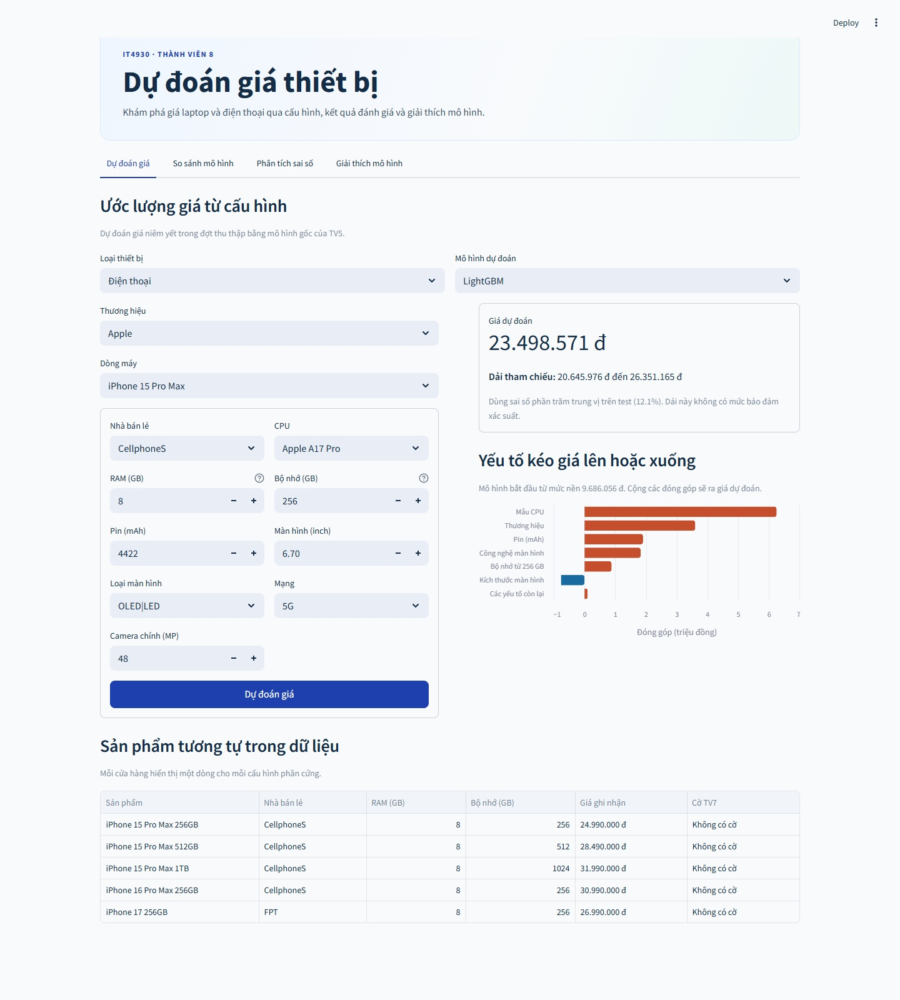

# Phần 10. Đánh giá mô hình, giải thích dự đoán và demo

**Dự án IT4930 — Thành viên 8**

TV8 đánh giá khả năng ước lượng **giá niêm yết tại đợt thu thập** của laptop và điện thoại. Công việc gồm đối chiếu sáu mô hình TV5, tìm các nhóm hay dự đoán sai, đo tác động của dữ liệu TV3–TV7, giải thích dự đoán và đưa kết quả vào một demo có thể chạy cục bộ. Các kết quả dưới đây sử dụng cùng một phép chia dữ liệu, nên chênh lệch giữa các phiên bản có thể đối chiếu theo từng dòng test.

## 10.1. Dữ liệu và cách đánh giá

Dữ liệu sản phẩm được cố định ở commit `24cd858`. Ghép bảng đã làm sạch với bảng processed theo `listing_record_id` khớp đủ **8.374/8.374 dòng**. Sau các ngưỡng giá của TV5 (laptop từ 3 triệu đồng, điện thoại từ 1 triệu đồng), còn **8.143 dòng** đủ điều kiện. Dùng `GroupShuffleSplit` với seed 42 và nhóm `source_parent_id`. Các biến thể cùng sản phẩm cha trong một nguồn vào cùng một tập. Cùng một dòng máy ở hai cửa hàng có thể mang hai mã cha khác nhau, vì vậy đây là đánh giá theo nhóm sản phẩm cha trong nguồn.

| Loại thiết bị | Train | Test |
|---|---:|---:|
| Laptop | 3.227 | 819 |
| Điện thoại | 3.300 | 797 |

Mã định danh được giữ riêng để ghép và kiểm toán. Mô hình hồi quy học trên `log1p(giá)`, sau đó đổi kết quả về VNĐ trước khi tính sai số. Giá gốc, tỷ lệ giảm giá, cụm đồ thị có dùng giá và cờ bất thường cũng nằm ngoài đầu vào. TV8 tái tạo đúng mã dòng test cho mọi bước và giữ nguyên 1.616 dòng test ngay cả khi lọc train ở S5. [Mã chia dữ liệu](../../src/evaluation_demo/prepare_test_data.py)

Đề cương nêu chiến lược kết hợp 10-fold cross-validation với tập kiểm thử độc lập. Mã TV5 dùng `GroupKFold(n_splits=10)` để tìm tham số Random Forest và LightGBM trong train. Phần 10 của TV8 báo cáo các chỉ số đo trên tập test đã chốt. [Mã huấn luyện Random Forest](../../src/price_prediction/models/training_rf.py) · [Mã huấn luyện LightGBM](../../src/price_prediction/models/training_lgbm.py)

## 10.2. So sánh sáu mô hình TV5

MAE là trung bình độ lệch tuyệt đối và RMSE phạt mạnh các dự đoán sai lớn. MdAE, MAPE, MdAPE và R² bổ sung cách nhìn về trung vị, sai số theo tỷ lệ và mức độ khớp. Thời gian là trung bình của 30 lần dự đoán từng dòng sau lượt làm nóng, tính trên máy chạy thử và bỏ thời gian nạp mô hình. Độ nhạy được đo bằng mức tăng MAE sau khi che ngẫu nhiên 20% giá trị đang có của RAM và 20% giá trị đang có của bộ nhớ, dùng cùng mặt nạ giữa ba mô hình của mỗi loại thiết bị.

| Thiết bị | Mô hình | MAE (triệu đ) | RMSE (triệu đ) | R² | ms/mẫu | MB | MAE tăng khi thiếu thông số |
|---|---|---:|---:|---:|---:|---:|---:|
| Laptop | Ridge | 4,945 | 8,693 | 0,821 | 12,93 | 0,067 | 13,52% |
| Laptop | Random Forest | 4,074 | 7,487 | 0,867 | 21,89 | 49,062 | 28,04% |
| Laptop | LightGBM | 3,768 | 6,859 | 0,889 | 16,51 | 2,425 | 22,28% |
| Điện thoại | Ridge | 2,681 | 7,342 | 0,801 | 11,52 | 0,034 | 11,74% |
| Điện thoại | Random Forest | 2,644 | 6,757 | 0,832 | 22,20 | 32,523 | 28,09% |
| Điện thoại | LightGBM | 2,510 | 7,373 | 0,800 | 19,82 | 0,647 | 27,15% |

LightGBM có MAE thấp nhất cho cả hai loại thiết bị. Với điện thoại, Random Forest có RMSE thấp hơn LightGBM khoảng 616 nghìn đồng, nên xếp hạng thay đổi khi ưu tiên giảm các lỗi lớn. Ridge có tệp nhỏ nhất, dự đoán nhanh nhất và mức tăng MAE nhỏ nhất trong phép che thông số này. [Bảng 10.1 — Kết quả đầy đủ](../../src/evaluation_demo/outputs/tables/table_10_1_model_benchmark_3d.csv)

## 10.3. Mô hình sai ở đâu?

Sai số có dấu bằng giá dự đoán trừ giá ghi nhận. Một điểm âm trên Hình 10.1 cho biết mô hình định giá thấp hơn dữ liệu. Hình 10.2 dùng MAE và số dòng của các nhóm giá và cửa hàng để đọc sai số cùng với cỡ mẫu.

- **Theo khoảng giá.** LightGBM điện thoại có MAE **1,028 triệu đồng** trên 450 dòng dưới 10 triệu, so với **9,174 triệu đồng** trên 66 dòng trên 35 triệu. Ở nhóm trên 35 triệu, mô hình định giá thấp hơn giá ghi nhận trung bình **7,996 triệu đồng**. [Bảng 10.3](../../src/evaluation_demo/outputs/tables/table_10_3_error_by_price_tier.csv)
- **Theo hãng và nhà bán lẻ.** Các nhóm có số dòng rất khác nhau. Khi trình bày chênh lệch MAE, đọc `n_test` cùng với giá trị sai số, nhất là ở hãng hoặc cửa hàng ít mẫu. [Bảng 10.4](../../src/evaluation_demo/outputs/tables/table_10_4_error_by_brand_and_seller.csv)
- **Theo tồn kho và mức đầy đủ thông số.** LightGBM điện thoại có MAE **5,605 triệu** ở 100 dòng thiếu RAM và **2,066 triệu** ở 697 dòng có RAM. Theo tồn kho, hai nhóm còn hàng và hết hàng có MAE lần lượt **3,490** và **1,999 triệu đồng**. Đây là chênh lệch quan sát trên những nhóm khác nhau. [Bảng 10.5](../../src/evaluation_demo/outputs/tables/table_10_5_error_by_stock_and_missingness.csv)
- **Theo cấu hình đã thấy ở cửa hàng khác.** Dùng khóa hãng, model, RAM và bộ nhớ để tìm trong train. LightGBM điện thoại có MAE **1,902 triệu** trên 171 dòng tìm được ở cửa hàng khác và **2,082 triệu** trên 520 dòng có đủ cấu hình nhưng chưa gặp khóa trong train. Cùng khóa này vẫn có thể khác CPU hoặc các chi tiết khác. [Bảng 10.6](../../src/evaluation_demo/outputs/tables/table_10_6_cross_store_generalization.csv)
- **Hai mươi dòng sai nhiều nhất.** Mỗi dòng xuất hiện một lần, gắn mô hình sai nhiều nhất trong ba thuật toán. Có 6 dòng mang cờ `review` và 14 dòng mang `none`. Ví dụ XOR Titanium X2 Ebony Bundle ghi nhận **196 triệu đồng**, Ridge dự đoán **32,18 triệu đồng** và TV7 gắn `none`. Đây là đầu mối để đối chiếu lại sản phẩm, gói bán và giá trên nguồn. [Bảng 10.7](../../src/evaluation_demo/outputs/tables/table_10_7_top20_worst_predictions_audit.csv)

[Hình 10.1 — Giá ghi nhận, dự đoán và sai số](../../src/evaluation_demo/outputs/figures/fig_10_1_residual_and_actual_vs_pred.png) · [Hình 10.2 — Sai số theo giá và cửa hàng](../../src/evaluation_demo/outputs/figures/fig_10_2_error_by_price_tier_and_seller.png)

## 10.4. Thử từng nhóm đặc trưng

**S1** huấn luyện lại bằng bộ đặc trưng của TV5, với Ridge `alpha=1`, Random Forest 200 cây và LightGBM 200 cây. S1 là mốc tham số cố định của TV8. Các mô hình đã tối ưu do TV5 bàn giao được dùng cho Bảng 10.1 và demo dự đoán. S2–S5 giữ tham số của S1 và cùng tập test, để so sánh khi đổi đầu vào hoặc lọc train.

**S2** thử cờ hết hàng, sửa màn hình `300 inch`, thêm công suất sạc và cờ thiếu sạc. Thông tin sạc laptop chỉ có ở **88/3.227 dòng train**. Khi so sánh trực tiếp với bản **S2A** gồm cờ hết hàng và sửa màn hình, hai cột về sạc giảm MAE ở LightGBM laptop và Random Forest điện thoại, các mô hình còn lại có mức tăng từ nhẹ đến gần 2,51%. Chọn S2A làm mốc chung cho S3. [Đối chiếu thông tin sạc](../../src/evaluation_demo/outputs/tables/s2_charger_comparison.csv)

**S3** thêm điểm CPU/GPU của TV4 và số cửa hàng có cùng nhóm hãng, model, RAM, bộ nhớ. Điểm phần cứng được ghép theo mã listing từ commit `a4874b0`. Test có điểm ở **729/819 CPU laptop**, **412/819 GPU laptop** và **497/797 CPU điện thoại**. Điểm thiếu được điền bằng trung vị train. Điện thoại dùng điểm CPU tổng hợp vì cột Geekbench 5 trùng điểm khi cả hai cùng có. Đếm các cửa hàng khác từ những cấu hình có trong train, rồi cộng cửa hàng của dòng đang xét nếu khóa đủ thông tin. So với S2A, MAE giảm ở cả ba mô hình laptop. LightGBM laptop giảm **8,76%**. Ở điện thoại, Ridge giảm nhẹ, còn Random Forest và LightGBM tăng nhẹ.

**S4** nối review TV6 từ commit `1d53f97` theo sản phẩm cha. Bản đếm thêm cờ có review và số review dùng được. Bản đầy đủ còn thêm cảm xúc chung, tỷ lệ tích cực, cảm xúc theo khía cạnh và trung bình cảm xúc theo hãng. Khi tính trung bình, mỗi sản phẩm cha có review trong train đóng góp một lần và giá trị của chính sản phẩm đó được loại khỏi phép tính nếu truy vấn một dòng train. Chỉ **234/819 laptop** và **551/797 điện thoại** trong test thực sự có review. TV6 chấm cảm xúc trên tập review của đợt thu thập với phép chia riêng ở cấp review, nên đây là đánh giá dùng kết quả bàn giao có sẵn trên snapshot.

| Thiết bị | Mô hình | S1 | S2A | S3 | S3 + bản đếm | S4 đầy đủ |
|---|---|---:|---:|---:|---:|---:|
| Laptop | Ridge | 4,945 | 4,813 | 4,552 | 4,406 | 4,573 |
| Laptop | Random Forest | 4,202 | 4,139 | 4,045 | 4,052 | 4,039 |
| Laptop | LightGBM | 4,064 | 4,074 | 3,717 | 3,672 | 3,726 |
| Điện thoại | Ridge | 2,681 | 2,695 | 2,675 | 2,676 | 2,664 |
| Điện thoại | Random Forest | 2,550 | 2,589 | 2,626 | 2,563 | 2,576 |
| Điện thoại | LightGBM | 2,469 | 2,457 | 2,469 | 2,441 | 2,398 |

*MAE tính bằng triệu đồng. Đường S1 → S2A → S3 → S4 là chuỗi thí nghiệm chính. Bản đếm là phép so riêng để xem giá trị bổ sung của cảm xúc.*

S4 giảm MAE ở cả ba mô hình điện thoại so với S3. Bản đếm vẫn tốt hơn S4 đầy đủ cho Random Forest điện thoại, Ridge laptop và LightGBM laptop. Trên nhóm có review, S4 giảm MAE ở cả sáu mô hình. Trên nhóm thiếu review, chỉ LightGBM điện thoại giảm. Điều này cho thấy lợi ích của review phụ thuộc vào độ phủ và thuật toán. [Kết quả theo nhóm có/thiếu review](../../src/evaluation_demo/outputs/tables/s4_review_comparison.csv)

## 10.5. Thử lọc dữ liệu theo cờ TV7

**S5a** lọc dòng train có `anomaly_severity=extreme`. **S5b** lọc mọi dòng train có `combined_flag`. Dùng cờ bàn giao ở commit `66f089b` cho so sánh hồi cứu. Do TV7 ban đầu dùng toàn bộ giá trong snapshot để tính cờ, TV8 chạy lần thứ hai bằng cách tính lại cờ chỉ từ tập train. Hai nguồn cờ được ghi riêng trong kết quả. Khi huấn luyện lại, các thống kê điền thiếu, số nhà bán lẻ và trung bình cảm xúc theo hãng được tính từ phần train còn lại.

| Thiết bị | Mô hình | S5a, cờ bàn giao | S5b, cờ bàn giao | S5a, cờ chỉ từ train | S5b, cờ chỉ từ train |
|---|---|---:|---:|---:|---:|
| Laptop | Ridge | −0,01% | −0,24% | −0,01% | −3,55% |
| Laptop | Random Forest | −0,36% | +7,67% | −0,36% | +8,10% |
| Laptop | LightGBM | +0,48% | +0,05% | +0,48% | +1,48% |
| Điện thoại | Ridge | +2,41% | +2,86% | +2,35% | +3,87% |
| Điện thoại | Random Forest | +5,57% | +2,90% | −1,04% | −0,73% |
| Điện thoại | LightGBM | +3,54% | +11,90% | −1,57% | +13,61% |

*Phần trăm thay đổi MAE so với S4. Giá trị âm là sai số giảm.*

Với cờ bàn giao, S5a bỏ 5 laptop và 10 điện thoại. S5b bỏ 121 laptop, 63 điện thoại, trong đó có **10/13 dòng train điện thoại giá từ 80 triệu đồng**. Trên 11 điện thoại test thuộc nhóm giá này, LightGBM có MAE **20,0 triệu** ở S4 và **40,4 triệu** ở S5b. Với cờ tính lại từ train, MAE nhóm giá cao ở S5b vẫn khoảng **40,3 triệu đồng**. Cờ TV7 là tín hiệu rà soát, nên giữ S4 làm mốc và xem các trường hợp gắn cờ trước khi quyết định loại dòng. [Bảng 10.2](../../src/evaluation_demo/outputs/tables/table_10_2_ablation_and_tv7_sensitivity.csv) · [Chi tiết S5](../../src/evaluation_demo/outputs/tables/s5_tv7_sensitivity_details.csv) · [Hình 10.3](../../src/evaluation_demo/outputs/figures/fig_10_3_ablation_and_sensitivity_chart.png)

## 10.6. Giải thích mô hình và kiểm tra RAM/bộ nhớ

TreeSHAP của LightGBM S4 được tính trên toàn bộ **819 laptop và 797 điện thoại test**. Trong biểu đồ tổng quan, mỗi điểm là một listing và giá trị dương đẩy dự đoán lên so với mức nền. Độ dài thanh bên phải là trung bình độ lớn đóng góp. Mẫu CPU đứng đầu ở cả hai loại thiết bị. Laptop tiếp theo là RAM × bộ nhớ và mẫu GPU. Điện thoại tiếp theo là bộ nhớ và thương hiệu. [Hình 10.4 — Laptop](../../src/evaluation_demo/outputs/figures/fig_10_4_shap_summary_laptop.png) · [Hình 10.5 — Điện thoại](../../src/evaluation_demo/outputs/figures/fig_10_5_shap_summary_smartphone.png)

Biểu đồ giải thích từng máy phân bổ chênh lệch giá từ mức nền sang VNĐ theo tỷ lệ các giá trị SHAP trên thang log. Kiểm tra cộng tính xác nhận mức nền và tổng đóng góp khớp dự đoán. Chẳng hạn, OPPO Reno7 Z 5G có mức nền **9,66 triệu đồng**, mẫu CPU đóng góp khoảng **−2,34 triệu** và bộ nhớ khoảng **−1,36 triệu**. Sau khi cộng tất cả, dự đoán **7,08 triệu đồng** so với giá ghi nhận **7,00 triệu đồng**. Các phần đóng góp giải thích cách mô hình tạo dự đoán trong trường hợp cụ thể. [Hình 10.6 — Ba ví dụ](../../src/evaluation_demo/outputs/figures/fig_10_6_shap_waterfall_examples.png)

Thử tăng RAM 8, 16, 32, 64 GB và bộ nhớ 128, 256, 512, 1.024 GB, mỗi lần thay một thông số của ASUS Vivobook 15 OLED hoặc OPPO Find N3. Các đầu vào còn lại lấy từ dòng tham chiếu. Các đặc trưng dẫn xuất của thông số đang thay tiếp tục được tính theo pipeline. Trong 12 đường thử, dự đoán giữ nguyên hoặc tăng giữa các mốc. Tuy nhiên, tập train điện thoại thiếu mức RAM 32 và 64 GB. Ridge lên tới **1,81 tỷ đồng** ở 64 GB trên cấu hình điện thoại giả lập. Đây là ví dụ về ngoại suy ngoài dữ liệu và là lý do demo giới hạn RAM điện thoại ở 24 GB, đồng thời cảnh báo mức cấu hình chưa thấy trong train. [Hình 10.7 — Phép thử dung lượng](../../src/evaluation_demo/outputs/figures/fig_10_7_monotonicity_sanity_check.png) · [Bảng dự đoán RAM/bộ nhớ](../../src/evaluation_demo/outputs/tables/monotonicity_sweeps.csv)

## 10.7. Demo và bàn giao

Tab nhập cấu hình dùng mô hình **TV5 gốc**, đồng bộ với Bảng 10.1. Các kết quả S1–S5 và SHAP S4 được ghi rõ phiên bản ở các tab phân tích. Dải giá tham chiếu dựa vào MdAPE của tập test. Các máy tương tự được xếp bằng cấu hình, không dùng giá làm tiêu chí xếp hạng. Luồng trình bày có thể bắt đầu từ iPhone 15 Pro Max 8 GB/256 GB tại CellphoneS, dự đoán **23.498.571 đồng** bằng LightGBM. Ca kiểm thử tên `apple` và `fpt shop` với cùng cấu hình cơ bản cho dự đoán **24.892.339 đồng** bằng Random Forest sau khi chuẩn hóa nhãn.

| Tab | Nội dung | Ảnh chụp thực tế |
|---|---|---|
| Dự đoán giá | Chọn cấu hình, xem giá, đóng góp và các máy tương tự | [Ảnh 10.A](../../src/evaluation_demo/outputs/demo_screenshots/01_du_doan_gia.jpg) |
| So sánh mô hình | Chỉ số TV5, các giai đoạn S1–S4 và độ nhạy với cờ TV7 | [Ảnh 10.B](../../src/evaluation_demo/outputs/demo_screenshots/02_so_sanh_mo_hinh.jpg) |
| Phân tích sai số | Đồ thị sai số, nhóm giá/hãng/tồn kho và ca dự đoán lệch | [Ảnh 10.C](../../src/evaluation_demo/outputs/demo_screenshots/03_phan_tich_sai_so.jpg) |
| Giải thích mô hình | Hai biểu đồ SHAP, ba ví dụ và phép thử RAM/bộ nhớ | [Ảnh 10.D](../../src/evaluation_demo/outputs/demo_screenshots/04_giai_thich_mo_hinh.jpg) |



[Hướng dẫn chạy và tái tạo hiện vật](../../src/evaluation_demo/README.md) · [Mã demo](../../src/evaluation_demo/app.py) · [Thư viện](../../requirements.txt) · [Bộ kiểm thử TV8](../../tests/test_tv8_evaluation_demo.py)

```powershell
python -m pytest tests/test_tv8_evaluation_demo.py -q
python -m streamlit run src/evaluation_demo/app.py --server.address 127.0.0.1
```

Bộ kiểm thử đối chiếu sáu mô hình và tập test, ca chuẩn hóa Apple/FPT, tổng đóng góp của giải thích, bảy bảng, bảy hình 300 DPI, bốn ảnh demo và thao tác dự đoán trong Streamlit. **Cả 32 kiểm thử TV8 đều đạt** trên Anaconda cục bộ với Streamlit 1.45.1 và LightGBM 4.7.0. Bản demo cũng đã được kiểm tra bằng trình duyệt ở chiều rộng 1.440 px và 375 px. Scikit-learn trong môi trường này cũ hơn phiên bản lưu mô hình và phát cảnh báo khi nạp. So sánh MAE và RMSE với Bảng 10.1 xác nhận sáu mô hình TV5 vẫn cho cùng kết quả tại môi trường này.
