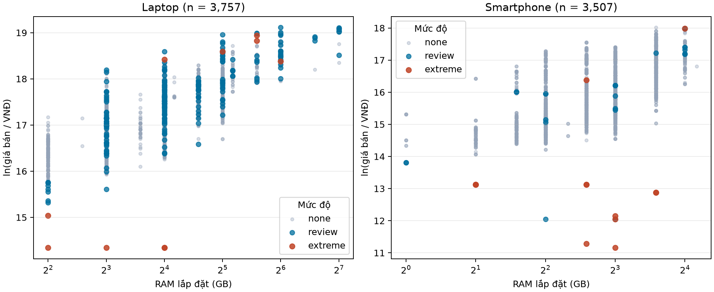

# Phát hiện bất thường trong dữ liệu và giá sản phẩm

- Đầu vào: `data/processed/products_processed.jsonl` (10,316 bản ghi).
- Phương pháp: IQR trên log(giá), so sánh laptop/smartphone riêng; dùng nhóm thương hiệu khi có ít nhất 20 bản ghi, nếu không dùng nhóm danh mục.
- Isolation Forest chạy riêng cho laptop/smartphone với 300 cây, `contamination=0.02` và `random_state=42`; mô hình dùng log giá, cấu hình, cờ thiếu và tần suất của đặc trưng phân loại.
- Quy tắc kiểm tra giá dưới sàn EDA (laptop 3 triệu, smartphone 1 triệu), máy bàn Apple bị xếp vào laptop, kích thước màn hình ngoài miền, ổ laptop dưới 32 GB và giá tiền lẫn vào loại mạng. Quy tắc phi giá cũng áp dụng cho listing thiếu giá hoặc giá không dương.
- Các cờ chỉ là tín hiệu rà soát; không xóa bản ghi và không khẳng định mọi giá trị bị gắn cờ là lỗi.
- Giá hợp lệ: 8,548; cờ tổng hợp: 715; mức extreme: 106.

## Tổng hợp theo phương pháp

| method                     |   flagged |
|:---------------------------|----------:|
| EDA and data quality rules |       494 |
| IQR                        |       156 |
| Isolation Forest           |       172 |
| Combined union             |       715 |
| At least 2 methods         |       102 |

## Tổng hợp theo danh mục

| category_group   | price_status           | anomaly_severity   |   records |
|:-----------------|:-----------------------|:-------------------|----------:|
| laptop           | missing_or_unparseable | none               |         2 |
| laptop           | non_positive           | none               |       637 |
| laptop           | non_positive           | review             |        13 |
| laptop           | valid                  | extreme            |        17 |
| laptop           | valid                  | none               |      3885 |
| laptop           | valid                  | review             |       320 |
| smartphone       | missing_or_unparseable | none               |        14 |
| smartphone       | non_positive           | none               |      1068 |
| smartphone       | non_positive           | review             |        34 |
| smartphone       | valid                  | extreme            |        89 |
| smartphone       | valid                  | none               |      3995 |
| smartphone       | valid                  | review             |       242 |

## Phân loại và hướng xử lý

| category_group   | anomaly_type                | recommended_action      |   records |
|:-----------------|:----------------------------|:------------------------|----------:|
| laptop           | hardware_spec_error         | verify_or_correct_specs |        34 |
| laptop           | low_price_or_category_noise | filter_before_modeling  |       172 |
| laptop           | rare_valid_flagship         | keep_with_log_transform |        53 |
| laptop           | spec_price_mismatch_review  | sensitivity_check       |        91 |
| smartphone       | hardware_spec_error         | verify_or_correct_specs |        59 |
| smartphone       | low_price_or_category_noise | filter_before_modeling  |       229 |
| smartphone       | rare_valid_flagship         | keep_with_log_transform |        12 |
| smartphone       | spec_price_mismatch_review  | sensitivity_check       |        65 |

Ưu tiên lỗi giá thấp/sai danh mục, sau đó đến lỗi thông số. Listing trên biên IQR, có RAM từ 32 GB, storage từ 1.024 GB hoặc RTX 4080/4090 và không vi phạm quy tắc được đề xuất giữ lại. Các cờ thống kê còn lại cần kiểm tra độ nhạy. Nhãn flagship là nhận định sơ bộ dựa trên cấu hình.

## Phân bố giá theo RAM

Biểu đồ chỉ gồm listing có giá và RAM dương. Trục RAM dùng thang log cơ số 2.

## Độ nhạy mô hình dự đoán giá TV5

Số liệu từ Bảng 1 và Bảng 2, mục TV5.B của [báo cáo kiểm toán](../../../BAO_CAO_KIEM_TOAN_CUOI_CUNG_TV1_TV7_VA_CHI_DAN_TV8.md). Đây là kết quả dùng bộ cờ trước khi bổ sung quy tắc phần cứng. S4 là mốc so sánh; S5a lọc `extreme` và S5b lọc `combined_flag` trên tập train. Mỗi danh mục giữ cùng tập test.

| category   | stage   | train_filter          | mae_vnd   | rmse_vnd   | mape_pct   | r2     |
|:-----------|:--------|:----------------------|:----------|:-----------|:-----------|:-------|
| laptop     | S4      | baseline              | 3985608   | 7104989    | 12.43      | 0.8805 |
| laptop     | S5a     | exclude_extreme       | 3975005   | 7143663    | 12.42      | 0.8792 |
| laptop     | S5b     | exclude_combined_flag | 4329085   | 8314281    | 12.88      | 0.8364 |
| smartphone | S4      | baseline              | 2522719   | 6189160    | 19.98      | 0.8588 |
| smartphone | S5a     | exclude_extreme       | 2705635   | 7455352    | 20.25      | 0.7952 |
| smartphone | S5b     | exclude_combined_flag | 2908920   | 8956429    | 20.88      | 0.7044 |

S5a giảm MAE laptop 10.603 VNĐ nhưng làm RMSE tăng và R² giảm nhẹ. Trên smartphone, cả MAE và RMSE đều tăng. S5b làm R² giảm trên cả hai danh mục, phù hợp với rủi ro mất dữ liệu về phân khúc cao cấp khi lọc mọi cờ.

## Bàn giao cho TV5 và TV8

Ghép theo `listing_record_id`. Các cờ và điểm số, kể cả `anomaly_type` và `recommended_action`, có thể phụ thuộc vào giá thực tế. Giữ chúng ngoài tập đặc trưng X của mô hình dự đoán giá. TV5 dùng cờ để lọc hoặc kiểm tra độ nhạy trên tập train. TV8 dùng cờ để giải thích các sai số lớn sau khi dự đoán trên tập test.

## Cách đọc kết quả

`rule_flag`, `iqr_flag` và `isolation_forest_flag` cho biết phương pháp nào đã gắn cờ. `isolation_score` càng lớn thì tổ hợp đặc trưng càng khác thường trong danh mục. `methods_agree >= 2` được ưu tiên kiểm tra và xếp mức `extreme`; cờ IQR vượt 3 IQR cũng là `extreme`. `combined_flag` là hợp của ba phương pháp.

## Hạn chế

Isolation Forest là mô hình không giám sát và `contamination=0.02` buộc mô hình chọn khoảng 2% bản ghi giá hợp lệ trong mỗi danh mục. Cờ này không phải xác suất lỗi hoặc gian lận. IQR và Isolation Forest đều có thể đánh dấu flagship hay sản phẩm hiếm hợp lệ. Cần đối chiếu raw data/trang nguồn và rà soát thủ công trước khi lọc. Nhóm dự đoán có thể dùng các cờ để so sánh độ nhạy giữa giữ nguyên dữ liệu, chỉ bỏ lỗi đã xác minh và bỏ toàn bộ anomaly.
