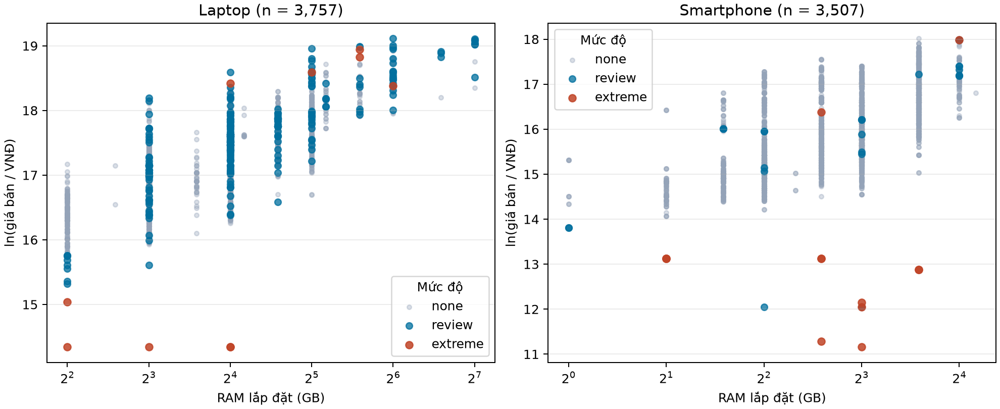

# PHẦN 9: PHÁT HIỆN BẤT THƯỜNG TRONG DỮ LIỆU VÀ GIÁ SẢN PHẨM

**Thành viên phụ trách**: Thành viên 7 (TV7 - Market Anomaly Detection)  
**Tập dữ liệu đầu vào**: `data/processed/products_processed.jsonl`  
**Quy mô dữ liệu**: 10.316 listing thuộc hai ngành hàng Laptop và Smartphone  
**Mã nguồn thực nghiệm**: `src/anomaly_detection/detect_price_anomalies.py`

---

## 9.1. Mục tiêu và phạm vi bài toán

Mục tiêu của phần này là phát hiện các listing có giá hoặc tổ hợp giá–cấu hình khác thường so với mặt bằng thị trường. Kết quả được sử dụng để:

1. Hỗ trợ kiểm tra lỗi thu thập và chuẩn hóa dữ liệu;
2. Xác định các sản phẩm có mức giá cần được rà soát;
3. Phân biệt sơ bộ lỗi dữ liệu với sản phẩm hiếm nhưng hợp lệ;
4. Cung cấp cờ chất lượng cho nhóm xây dựng mô hình dự đoán giá;
5. Đánh giá độ nhạy của mô hình hồi quy khi giữ lại hoặc xử lý các trường hợp bất thường.

Trong ngữ cảnh thương mại điện tử, một **anomaly** là listing khác đáng kể so với các sản phẩm tương đồng về giá, cấu hình hoặc đặc điểm thị trường. Một listing được gắn cờ chưa đồng nghĩa với dữ liệu sai. Nó có thể là:

- **Lỗi dữ liệu**: sai đơn vị tiền tệ, thiếu chữ số, lấy nhầm giá trả góp/đặt trước, hoặc phụ kiện bị gắn nhãn sản phẩm;
- **Ngoại lệ tự nhiên**: flagship, workstation, điện thoại xa xỉ hoặc cấu hình đặc biệt;
- **Trường hợp cần điều tra**: mức giá có thể là khuyến mại thật nhưng khác xa mặt bằng thị trường.

Dự án không có nhãn xác thực về hành vi gian lận. Vì vậy, kết quả được gọi là **Market Anomaly Detection**, không phải Fraud Detection. Pipeline chỉ tạo cờ rà soát và không tự động xóa dữ liệu.

### 9.1.1. Các dạng bất thường có thể quan sát

- **Giá bất thường**: giá quá thấp/cao so với nhóm sản phẩm tương đồng; giá bằng 0, âm hoặc thiếu; giá không tương xứng với cấu hình.
- **Chiết khấu bất thường**: giá gốc thấp hơn giá bán, tỷ lệ giảm ngoài miền hợp lý, hoặc mức giảm gần 100%. `discount_rate` được dùng làm bằng chứng kiểm tra case, chưa được đưa vào mô hình Isolation Forest hiện tại để tránh để một biến được suy ra trực tiếp từ giá chi phối kết quả.
- **Rating/review bất thường**: rating ngoài thang 1–5, có rating nhưng không có review, hoặc quan hệ rating–review count khác thường. Đây là hướng mở rộng; pipeline hiện tại tập trung vào listing và giá vì độ bao phủ review không đồng đều.
- **Bất thường cấu trúc**: phụ kiện lẫn vào danh mục điện thoại, thông số phần cứng nằm ngoài miền hợp lý, hoặc các biến thể cùng sản phẩm có giá mâu thuẫn.

---

## 9.2. Dữ liệu đầu vào và tiền kiểm tra chất lượng

Dữ liệu gồm **4.874 laptop** và **5.442 smartphone**, thu thập từ CellphoneS, Thế Giới Di Động, FPT Shop, Hoàng Hà Mobile và Viettel Store. Trước khi phát hiện anomaly, trường `price_vnd` được ép về kiểu số và chia thành ba trạng thái:

| Trạng thái giá | Số bản ghi | Ý nghĩa xử lý |
|---|---:|---|
| Hợp lệ, lớn hơn 0 | 8.548 | Đưa vào IQR và Isolation Forest |
| Không dương | 1.752 | Giữ lại để audit, không đưa vào mô hình |
| Thiếu/không parse được | 16 | Giữ lại để audit, không đưa vào mô hình |
| **Tổng** | **10.316** | |

Trong **1.768 bản ghi không có target giá khả dụng**, 47 listing vẫn được gắn cờ bởi quy tắc phi giá. IQR và Isolation Forest chỉ xét 8.548 listing có giá dương.

Laptop và smartphone luôn được phân tích riêng vì phân phối giá, đặc trưng phần cứng và cơ chế định giá của hai ngành hàng khác nhau rõ rệt. Giá được biến đổi logarithm:

$$
z_i = \ln(price_i)
$$

Phép biến đổi này làm giảm độ lệch phải của phân phối giá và hạn chế việc các sản phẩm hàng trăm triệu đồng chi phối ngưỡng thống kê.

---

## 9.3. Phương pháp phát hiện bất thường

Pipeline kết hợp ba phương pháp có vai trò bổ sung: quy tắc nghiệp vụ từ EDA, IQR trên log giá và Isolation Forest đa biến.

### 9.3.1. Phương pháp 1 — Quy tắc tham chiếu từ EDA

Kết quả EDA và pipeline dự đoán giá xác định hai ngưỡng cần rà soát:

- Laptop có giá dưới **3.000.000 VNĐ**;
- Smartphone có giá dưới **1.000.000 VNĐ**.

Các ngưỡng giá ưu tiên kiểm tra phụ kiện gắn nhầm danh mục, giá trả góp/đặt trước và điện thoại phổ thông giá thấp. `rule_flag` cũng gắn cờ khi có ít nhất một vấn đề phi giá:

- Màn hình ngoài khoảng 10–20 inch đối với laptop hoặc 3–11 inch đối với smartphone.
- iMac, Mac Studio, Mac mini hoặc Mac Pro nằm trong danh mục laptop.
- Dung lượng lưu trữ laptop dưới 32 GB.
- `network_type_norm` chứa ký hiệu tiền VNĐ hoặc chuỗi số có dạng giá tiền.

Quy tắc phi giá áp dụng cả khi thiếu giá. Trường thông số trống không bị xem là giá trị vượt ngưỡng.

Ưu điểm của phương pháp là dễ giải thích và phát hiện nhanh lỗi rõ ràng. Hạn chế là ngưỡng được đặt thủ công và có thể đánh dấu điện thoại phổ thông hợp lệ.

### 9.3.2. Phương pháp 2 — IQR trên log giá

Khoảng tứ phân vị được xác định bởi:

$$
IQR = Q_3 - Q_1
$$

Một listing được gắn cờ IQR khi:

$$
z_i < Q_1 - 1.5IQR
\quad \text{hoặc} \quad
z_i > Q_3 + 1.5IQR
$$

Listing vượt khỏi biên $3IQR$ được đánh dấu `iqr_extreme_flag`. Nhóm so sánh được xây dựng như sau:

- Luôn tách Laptop và Smartphone;
- Nếu thương hiệu có ít nhất 20 bản ghi giá hợp lệ, dùng nhóm `(category, brand)`;
- Gộp các thương hiệu có ít hơn 20 bản ghi vào nhóm chung của danh mục để tính tứ phân vị.

IQR cung cấp baseline thống kê dễ diễn giải và cho biết giá có khác thường trong nhóm thị trường hay không. Tuy nhiên, phương pháp chủ yếu dựa vào giá nên chưa đánh giá đầy đủ quan hệ giữa giá và cấu hình.

### 9.3.3. Phương pháp 3 — Isolation Forest đa biến

Isolation Forest là mô hình học không giám sát. Mô hình xây dựng nhiều cây ngẫu nhiên và liên tục chia không gian đặc trưng. Điểm hiếm thường được cô lập bằng ít lần chia hơn điểm nằm trong vùng dữ liệu đông, do đó có đường đi trung bình ngắn hơn trong các cây.

Hai mô hình được huấn luyện độc lập cho Laptop và Smartphone với cấu hình:

| Tham số | Giá trị |
|---|---:|
| Số cây (`n_estimators`) | 300 |
| Tỷ lệ ưu tiên kiểm tra (`contamination`) | 0,02 |
| Hạt giống ngẫu nhiên (`random_state`) | 42 |
| Số luồng xử lý (`n_jobs`) | -1 |

`contamination=0.02` yêu cầu mô hình chọn khoảng 2% listing có tổ hợp đặc trưng khác thường nhất trong mỗi danh mục. Đây là **ngân sách rà soát**, không phải ước lượng tỷ lệ lỗi thật.

#### Bộ đặc trưng

| Nhóm | Laptop | Smartphone |
|---|---|---|
| Giá | `log(price_vnd)` | `log(price_vnd)` |
| Bộ nhớ | RAM, RAM tối đa, storage | RAM, storage |
| Hiển thị | Kích thước màn hình | Kích thước màn hình |
| Năng lượng | Pin Wh, công suất sạc | Pin mAh, công suất sạc |
| Camera | — | Camera MP |
| Phân loại | Thương hiệu, nguồn, CPU, GPU, màn hình, hệ điều hành | Các trường tương tự và loại mạng |
| Chất lượng dữ liệu | Cờ thiếu cho từng biến số | Cờ thiếu cho từng biến số |

Biến phân loại được biểu diễn bằng tần suất xuất hiện trong từng danh mục. Cách này giúp mô hình nhận diện giá trị hiếm mà không tạo thứ tự giả như Apple < Dell < Lenovo. Biến số thiếu được điền bằng trung vị và có thêm cờ thiếu để giữ lại tín hiệu về chất lượng dữ liệu.

Pipeline lưu giá trị $-score\_samples$ vào `isolation_score`, vì vậy điểm càng lớn thì record càng khác thường. Điểm này không phải xác suất lỗi.

### 9.3.4. Chiến lược kết hợp

Ba cờ được giữ riêng để đảm bảo khả năng giải thích:

- `rule_flag`: vi phạm quy tắc giá sàn, danh mục hoặc thông số;
- `iqr_flag`: giá vượt biên IQR của nhóm;
- `isolation_forest_flag`: tổ hợp giá–cấu hình khác thường;
- `methods_agree`: số phương pháp đồng thời gắn cờ;
- `combined_flag`: hợp của ba phương pháp.

Listing được xếp mức `extreme` khi vượt biên $3IQR$ hoặc có ít nhất hai phương pháp đồng thuận. Các listing có cờ còn lại được xếp mức `review`. Hai mức đều yêu cầu xác minh.

| `anomaly_type` | Tiêu chí theo thứ tự ưu tiên | `recommended_action` |
|---|---|---|
| `low_price_or_category_noise` | Giá dưới sàn hoặc máy bàn bị xếp vào laptop | `filter_before_modeling` |
| `hardware_spec_error` | Màn hình, lưu trữ hoặc loại mạng vi phạm quy tắc | `verify_or_correct_specs` |
| `rare_valid_flagship` | Giá vượt biên trên IQR và RAM ≥ 32 GB, storage ≥ 1.024 GB hoặc RTX 4080/4090 | `keep_with_log_transform` |
| `spec_price_mismatch_review` | Cờ thống kê còn lại, gồm giá dưới biên IQR dù trên sàn và ngoại lệ Isolation Forest | `sensitivity_check` |
| `none` | Listing không có cờ | `none` |

---

## 9.4. Kết quả thực nghiệm

### 9.4.1. Số lượng theo phương pháp

| Phương pháp | Số listing | Tỷ lệ trên 10.316 listing |
|---|---:|---:|
| Quy tắc EDA và chất lượng dữ liệu | 494 | 4,79% |
| IQR | 156 | 1,51% |
| Isolation Forest | 172 | 1,67% |
| Hợp ba phương pháp | 715 | 6,93% |
| Ít nhất hai phương pháp đồng thuận | 102 | 0,99% |

Tổng hợp theo danh mục:

| Danh mục | Giá hợp lệ | Quy tắc | IQR | Isolation Forest | Cờ tổng hợp |
|---|---:|---:|---:|---:|---:|
| Laptop | 4.222 | 206 | 75 | 85 | 350 |
| Smartphone | 4.326 | 288 | 81 | 87 | 365 |
| **Tổng** | **8.548** | **494** | **156** | **172** | **715** |

Trong 715 listing được gắn cờ, có **106 extreme** và **609 review**. Theo hướng xử lý, 401 listing thuộc nhóm giá thấp/sai danh mục, 93 listing cần kiểm tra thông số, 65 listing đạt tiêu chí flagship và 156 listing cần kiểm tra độ nhạy.

Snapshot hiện tại có 105 listing iMac trong danh mục laptop và cả 105 đều được gắn cờ. Các ví dụ màn hình 300 inch và giá tiền trong `network_type_norm` từ tài liệu kiểm toán được kiểm tra bằng dữ liệu thử vì snapshot hiện tại không có các giá trị đó.

Biểu đồ gồm các listing có giá và RAM dương. Trục RAM dùng thang log cơ số 2.

### 9.4.2. Mức độ đồng thuận

| Số phương pháp đồng thuận | Số listing | Diễn giải |
|---:|---:|---|
| 0 | 9.601 | Không có cờ từ ba phương pháp |
| 1 | 613 | Tín hiệu đơn lẻ, cần xem nguyên nhân cụ thể |
| 2 | 97 | Ưu tiên kiểm tra cao |
| 3 | 5 | Cả ba phương pháp gắn cờ, vẫn cần xác minh nguồn |

Năm listing được cả ba phương pháp gắn cờ gồm bốn listing giá 390.000 VNĐ từ Hoàng Hà Mobile và một listing giá 12.990.000 VNĐ từ Viettel Store. Các mức giá 390.000 VNĐ cần đối chiếu dữ liệu nguồn để xác định crawler có lấy giá trả trước hoặc một giá phụ hay không.

---

## 9.5. Phân tích case study

### Case 1 — Giá cực thấp có khả năng là lỗi trích xuất

**Samsung Galaxy Z Fold8 Ultra 5G 12GB/512GB — 390.000 VNĐ**

- Nguồn: Hoàng Hà Mobile;
- Giá gốc: 58.990.000 VNĐ;
- Tỷ lệ giảm được suy ra: 99,34%;
- Cấu hình: storage 512GB, pin 5.000mAh, camera 200MP, màn hình OLED/AMOLED;
- Cả quy tắc EDA, IQR và Isolation Forest đều gắn cờ;
- `isolation_score = 0,6425`.

Giá bán thấp hơn rất xa giá gốc và không tương xứng với cấu hình flagship. Đây là case cần ưu tiên truy vết tới raw payload. Nó minh họa lợi ích của sự đồng thuận giữa nhiều phương pháp.

### Case 2 — Phụ kiện bị gắn vào danh mục smartphone

**Cáp sạc Xiaomi Type C to C — 189.000 VNĐ**

- Danh mục hiện tại: Smartphone;
- Tên sản phẩm thể hiện đây là phụ kiện;
- Giá thấp hơn ngưỡng tham chiếu và biên IQR.

Case này là bất thường cấu trúc danh mục. Phương án xử lý phù hợp là sửa nhãn hoặc loại khỏi tập huấn luyện dự đoán giá smartphone, thay vì coi đây là smartphone giá rẻ.

### Case 3 — Ngoại lệ tự nhiên hợp lệ

**MacBook Pro 16 M5 Max, 128GB RAM/8TB — 269.990.000 VNĐ**

- Nguồn: FPT Shop;
- Giá cao hơn biên IQR;
- Cấu hình 128GB RAM và 8TB storage thuộc phân khúc đặc biệt cao;
- Isolation Forest không gắn cờ theo ngưỡng 2% hiện tại.

Tên sản phẩm giải thích được mức giá cao. Bản ghi hiện được xếp `spec_price_mismatch_review` vì các trường cấu hình chuẩn hóa chưa đáp ứng tiêu chí flagship. Cần xác minh cấu hình nguồn trước khi quyết định xử lý.

### Case 4 — Bất thường đa biến không bị IQR gắn cờ

Một số laptop gaming MSI/Acer giá khoảng 60–130 triệu VNĐ được Isolation Forest gắn cờ dù không vượt biên IQR của nhóm thương hiệu. Nguyên nhân là tổ hợp giá, CPU/GPU, RAM, storage, nguồn và mức độ thiếu dữ liệu khác với phần lớn listing trong danh mục. Đây là nhóm cần kiểm tra cấu hình trước khi kết luận: mô hình đã phát hiện tính hiếm đa biến, chưa chứng minh giá sai.

---

## 9.6. Kiểm tra và đánh giá kết quả khi không có ground truth

Do không có nhãn anomaly chuẩn, không thể sử dụng trực tiếp Accuracy, Precision, Recall hay F1-score. Quy trình validation phù hợp gồm:

1. **Kiểm tra quy tắc logic**: xác nhận giá thiếu/không dương không đi vào mô hình; laptop và smartphone được xử lý riêng; kết quả có thể tái lập nhờ `random_state=42`.
2. **Đồng thuận nhiều phương pháp**: ưu tiên 102 listing được ít nhất hai phương pháp gắn cờ, đặc biệt năm listing được cả ba phương pháp chọn.
3. **Đối chiếu dữ liệu nguồn**: kiểm tra `original_price_vnd`, discount, cấu hình, raw payload và URL sản phẩm để xác định giá bán thực tế.
4. **Rà soát thủ công có phân tầng**: lấy mẫu từ nhóm extreme, review, normal gần ngưỡng và normal ngẫu nhiên. Ít nhất hai thành viên nên gắn nhãn độc lập thành `data_error`, `valid_rare`, `normal` hoặc `uncertain`.
5. **Kiểm tra độ ổn định**: thử `contamination` 1%, 2% và 3%, thay đổi seed, rồi đo tỷ lệ listing tiếp tục được gắn cờ.
6. **Đánh giá ảnh hưởng downstream**: so sánh MAE, RMSE và $R^2$ của mô hình giá trong ba kịch bản: giữ toàn bộ giá hợp lệ; chỉ bỏ lỗi đã xác minh; bỏ toàn bộ anomaly.

### 9.6.1. Độ nhạy của mô hình TV5

Bảng dưới đây trích từ Bảng 1 và Bảng 2, mục TV5.B của [báo cáo kiểm toán](../../BAO_CAO_KIEM_TOAN_CUOI_CUNG_TV1_TV7_VA_CHI_DAN_TV8.md), dùng bộ cờ trước khi bổ sung quy tắc phần cứng. S4 là mốc so sánh. S5a lọc `extreme` và S5b lọc `combined_flag` trên tập train. Tập test được giữ cố định cho từng danh mục.

| Danh mục | Kịch bản | MAE (VNĐ) | RMSE (VNĐ) | MAPE | R² |
|---|---|---:|---:|---:|---:|
| Laptop | S4 | 3.985.608 | 7.104.989 | 12,43% | 0,8805 |
| Laptop | S5a | 3.975.005 | 7.143.663 | 12,42% | 0,8792 |
| Laptop | S5b | 4.329.085 | 8.314.281 | 12,88% | 0,8364 |
| Smartphone | S4 | 2.522.719 | 6.189.160 | 19,98% | 0,8588 |
| Smartphone | S5a | 2.705.635 | 7.455.352 | 20,25% | 0,7952 |
| Smartphone | S5b | 2.908.920 | 8.956.429 | 20,88% | 0,7044 |

S5a giảm MAE laptop 10.603 VNĐ đồng thời làm RMSE tăng. Trên smartphone, MAE và RMSE đều tăng. S5b cho R² thấp nhất ở cả hai danh mục, cho thấy rủi ro khi lọc đồng loạt các listing có cờ. [Bảng CSV cho TV5](outputs/tv5_sensitivity.csv)

---

## 9.7. Bàn giao cho nhóm dự đoán giá

File `outputs/anomaly_flags.csv` cung cấp các trường:

| Trường | Ý nghĩa |
|---|---|
| `price_status` | Trạng thái khả dụng của target giá |
| `comparison_group` | Nhóm được dùng để tính IQR |
| `rule_flag` | Cờ quy tắc giá, danh mục hoặc phần cứng |
| `iqr_flag` | Cờ ngoại lệ 1,5 IQR |
| `iqr_extreme_flag` | Cờ ngoại lệ 3 IQR |
| `isolation_forest_flag` | Cờ mô hình đa biến |
| `isolation_score` | Mức độ khác thường; càng lớn càng khác thường |
| `methods_agree` | Số phương pháp đồng thời gắn cờ |
| `combined_flag` | Hợp của ba phương pháp |
| `anomaly_severity` | Mức `none`, `review` hoặc `extreme` |
| `anomaly_reasons` | Lý do giải thích ở mức record |
| `anomaly_type` | Loại bất thường sơ bộ |
| `recommended_action` | Hướng xử lý theo loại |

Ghép kết quả theo `listing_record_id`. TV5 dùng các cờ để làm sạch hoặc kiểm tra độ nhạy trên tập train. TV8 ghép cờ với kết quả trên tập test sau khi dự đoán để giải thích các sai số lớn.

- Loại 1.768 record thiếu hoặc không có giá dương khỏi tập huấn luyện vì không có target hợp lệ;
- Giữ phân khúc flagship và xử lý theo `recommended_action` sau khi xác minh;
- Loại hoặc sửa các lỗi đã được xác minh, chẳng hạn phụ kiện sai danh mục hoặc giá bị lấy nhầm;
- Giữ mọi cờ và điểm TV7, gồm `isolation_score`, `anomaly_flag`, `combined_flag`, `anomaly_type` và `recommended_action`, ngoài tập đặc trưng đầu vào X vì chúng có thể phụ thuộc trực tiếp vào giá mục tiêu. Giữ `original_price_vnd` và `discount_rate` ngoài tập đặc trưng theo quy ước của nhóm.

---

## 9.8. Hạn chế và hướng phát triển

1. Không có ground truth nên chưa thể đo Precision/Recall của anomaly detector.
2. `contamination=0.02` là lựa chọn vận hành, không phải tỷ lệ lỗi thực tế.
3. Frequency encoding biểu diễn độ hiếm nhưng không thể hiện đầy đủ quan hệ ngữ nghĩa giữa các CPU/GPU.
4. Entity resolution xuyên sàn chưa hoàn chỉnh nên chưa thể so sánh chắc chắn cùng một model giữa mọi nhà bán.
5. Pipeline chưa có detector riêng cho discount và rating/review.
6. Dữ liệu là snapshot thị trường; chưa phát hiện được biến động giá bất thường theo thời gian.

Hướng phát triển gồm xây dựng benchmark được gắn nhãn thủ công, trích xuất CPU/GPU tier, thêm đặc trưng giá tương đối so với sản phẩm tương đồng, phát hiện discount bất thường, tổng hợp review theo sản phẩm và theo dõi price drift qua nhiều lần crawl.

---

## 9.9. Kết luận

Pipeline kết hợp quy tắc chất lượng dữ liệu, IQR và Isolation Forest. Trên 10.316 listing, hệ thống gắn cờ 715 listing, trong đó 668 có giá dương. Việc phân loại giúp nhóm mô hình nhận diện 65 listing có đặc điểm flagship để giữ lại trong quá trình xử lý dữ liệu huấn luyện.

Đóng góp quan trọng của phần này không nằm ở việc tự động xóa outlier, mà ở khả năng tạo danh sách ưu tiên có lý do, bảo toàn khả năng truy vết và hỗ trợ nhóm dự đoán giá đánh giá độ nhạy một cách có kiểm soát.

